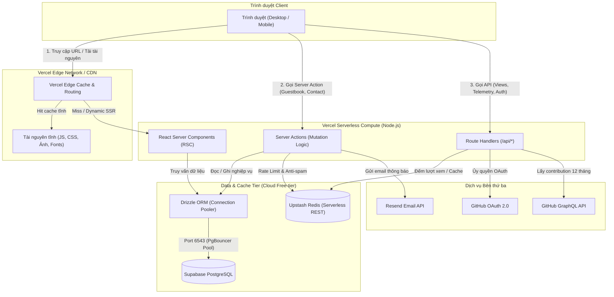
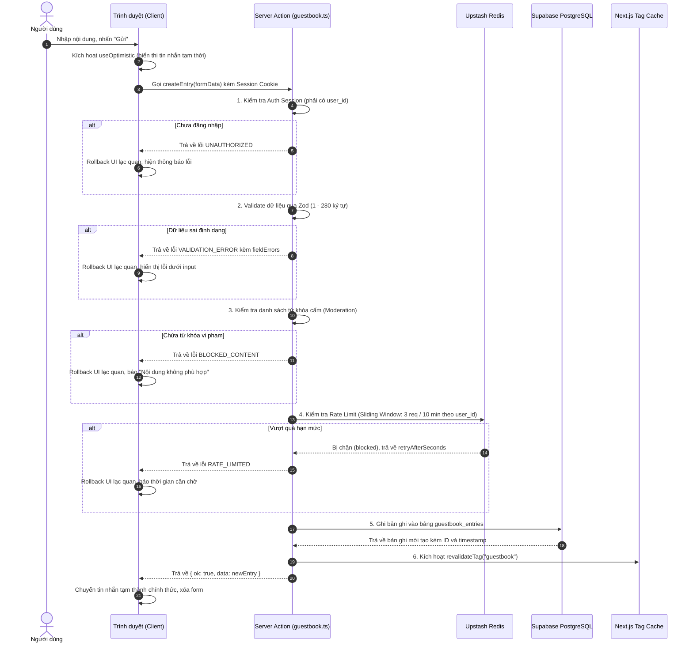
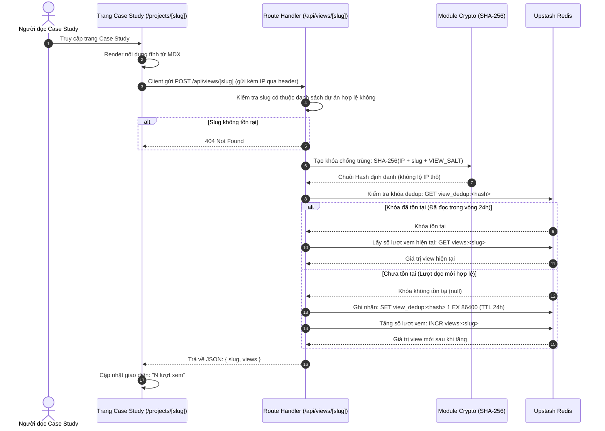
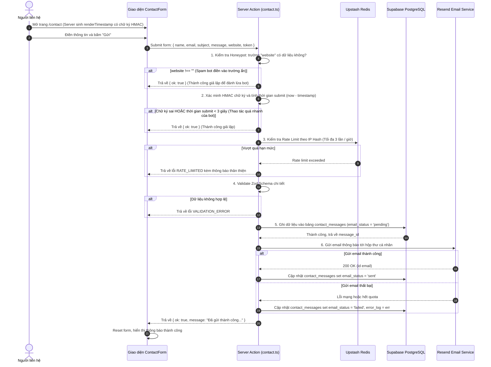
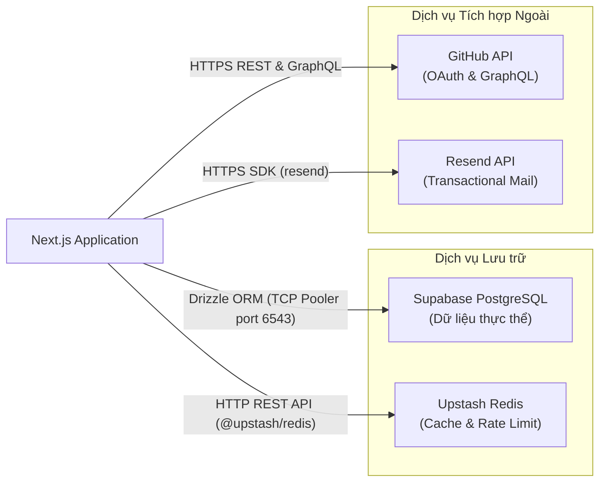

# Architecture - Kiến trúc Hệ thống Portfolio

Tài liệu này đặc tả toàn bộ kiến trúc kỹ thuật của hệ thống Portfolio, bao gồm phân tầng kiến trúc, luồng dữ liệu, cơ chế bảo mật, tích hợp dịch vụ bên thứ ba và phân tích lý do lựa chọn Tech Stack.

---

## 1. Tổng quan Kiến trúc Hệ thống (System Architecture Overview)

Hệ thống được thiết kế theo mô hình **Serverless Jamstack mở rộng** (Modern Full-stack Serverless), tận dụng mạng lưới phân phối biên (Edge Network) cho nội dung tĩnh và tài nguyên ảnh, kết hợp với các Serverless Compute Functions để xử lý tác vụ động, tương tác cơ sở dữ liệu và bảo mật.



### Các thành phần chính

1. **Client Tier:** Ứng dụng React chạy phía trình duyệt, ưu tiên xử lý giao diện nhẹ, bắt sự kiện người dùng, điều hướng phím tắt (`Ctrl + K`), cập nhật trạng thái lạc quan (Optimistic UI) và validate form sơ bộ.
2. **Edge Tier:** Mạng lưới CDN toàn cầu của Vercel đảm nhiệm cache nội dung tĩnh (HTML sinh từ SSG, tệp JavaScript, CSS, hình ảnh tối ưu từ `next/image`).
3. **Serverless Compute Tier:** Các hàm Node.js thực thi Server-Side Rendering (SSR), Server Actions (xử lý ghi dữ liệu) và Route Handlers (các endpoint REST/Webhook). Mã nguồn phía server luôn được cách ly an toàn (`import "server-only"`).
4. **Data & Cache Tier:**
   - **Supabase PostgreSQL:** Lưu trữ quan hệ chính (Users, Guestbook, Contact Messages).
   - **Upstash Redis:** Lưu trữ dạng Key-Value trong bộ nhớ, phục vụ cơ chế Rate Limiting chống spam và bộ đếm lượt xem (View Counter) thời gian thực không làm quá tải cơ sở dữ liệu chính.
5. **External Services Tier:** Kết nối với các hệ thống ngoài thông qua API chuẩn (GitHub API, Resend).

---

## 2. Chiến lược Rendering và Quản lý State

### 2.1. Chiến lược Rendering (Rendering Strategy)

Dự án áp dụng mô hình phân tách Server Components và Client Components theo tiêu chuẩn Next.js App Router:

| Trang / Tuyến đường | Phương thức Rendering | Lý do kỹ thuật | Cơ chế Revalidation |
| :--- | :--- | :--- | :--- |
| Trang chủ (`/`) | SSG (Static Site Generation) | Tối đa tốc độ tải trang ban đầu, First Contentful Paint < 0.8s | Rebuild khi có commit mới |
| Danh sách dự án (`/projects`) | SSG | Toàn bộ dữ liệu dự án đọc từ file MDX cục bộ | Rebuild khi có commit mới |
| Chi tiết dự án (`/projects/[slug]`) | SSG (`generateStaticParams`) | Sinh sẵn HTML cho mọi Case Study lúc build | Rebuild khi có commit mới |
| Component Lab (`/lab`) | SSG + Client Interactive | Khung trang tĩnh, tương tác props xử lý hoàn toàn tại client | Không cần revalidate |
| Sổ lưu niệm (`/guestbook`) | Dynamic SSR (kèm Cache Tag) | Cần đọc session đăng nhập của người dùng để quyết định hiển thị form hay nút đăng nhập | `revalidateTag("guestbook")` ngay khi có comment mới |
| Form liên hệ (`/contact`) | SSG + Server Action | Khung trang tĩnh, việc gửi tin nhắn thực hiện qua Server Action | Không cần revalidate |
| Telemetry API (`/api/telemetry`) | ISR (Incremental Static Regeneration) | Giảm thiểu số lượng request tới GitHub GraphQL API | `revalidate = 3600` (1 giờ) |
| Views API (`/api/views/[slug]`) | Dynamic (Edge / Serverless) | Ghi nhận và trả về số lượt xem tức thời | Không cache |

### 2.2. Chiến lược Quản lý State (State Management Strategy)

1. **Server State:** Quản lý thông qua Server Components và cơ chế caching của Next.js (`unstable_cache` / Fetch Cache). Dữ liệu được làm mới chính xác bằng hàm `revalidateTag` hoặc `revalidatePath`.
2. **URL State:** Sử dụng custom hook `useUrlState` đồng bộ trực tiếp trạng thái bộ lọc công nghệ tại `/projects?tech=nextjs` và cấu hình props trong `/lab?c=button&variant=danger`. Đảm bảo URL có thể chia sẻ (shareable) và lưu vết lịch sử trình duyệt đúng chuẩn.
3. **Optimistic State:** Áp dụng `useOptimistic` của React cho danh sách Guestbook. Khi người dùng bấm "Gửi", bình luận xuất hiện ngay trên màn hình với trạng thái mờ (opacity 60%), sau đó chuyển sang chính thức khi Server Action hoàn tất thành công.
4. **Local UI State:** Sử dụng React `useState` và `useReducer` cho các tương tác nội bộ của component (mở/đóng modal, trạng thái hover, bộ đếm ký tự). Tránh dùng các thư viện quản lý state toàn cục cồng kềnh như Redux khi phạm vi ứng dụng không cần thiết.

---

## 3. Sơ đồ Luồng Dữ liệu (Data Flows)

### 3.1. Luồng Gửi Lời nhắn Guestbook (Guestbook Submission)



### 3.2. Luồng Đếm Lượt xem Dự án (View Counter Flow)



### 3.3. Luồng Gửi Liên hệ và Chống Bot (Contact Form Flow)



---

## 4. Cơ chế Bảo mật và Xác thực (Security & Authentication)

### 4.1. Cơ chế Xác thực (Authentication)

- **Giao thức:** OAuth 2.0 Authorization Code Grant thông qua thư viện `Auth.js` (NextAuth v5).
- **Identity Provider duy nhất:** GitHub.
- **Quy trình quản lý phiên (Session Management):**
  - Sử dụng cơ chế Session lưu tại Database thông qua Drizzle Adapter. Bảng `sessions` lưu trữ token định danh phiên làm việc.
  - Cookie phiên được gắn các cờ bảo mật bắt buộc: `HttpOnly`, `Secure` (trên môi trường production), `SameSite=Lax`.
  - Thông tin user gắn kèm trong session gồm: `id` (UUID), `githubId` (số nguyên), `username`, `name`, `avatarUrl`, `isAdmin`.

### 4.2. Cơ chế Phân quyền (Authorization)

Hệ thống áp dụng mô hình phân quyền tối giản dựa trên vai trò (Role-Based Authorization):
- **Khách vãng lai (Anonymous):** Xem toàn bộ nội dung công khai, đọc Guestbook, gửi Contact form, xem và thử nghiệm Lab.
- **Người dùng đã đăng nhập (Authenticated User):** Được quyền tạo lời nhắn Guestbook, tự xóa lời nhắn do chính mình tạo ra (`entry.user_id === session.user.id`).
- **Chủ trang (Admin):** Được quyền xóa bất kỳ lời nhắn nào trong Guestbook. Quyền admin được xác định cứng thông qua so sánh biến môi trường:
  ```ts
  const isAdmin = Number(session.user.githubId) === Number(process.env.ADMIN_GITHUB_ID);
  ```
  *Lưu ý an ninh:* Tuyệt đối không so sánh theo username (vì username GitHub có thể thay đổi hoặc bị chuyển nhượng), luôn so sánh theo GitHub ID số nguyên duy nhất.

### 4.3. Phòng thủ Đa tầng và Chống Lạm dụng (Defense-in-Depth & Anti-Abuse)

1. **Kiểm tra biên (Boundary Validation):** 100% dữ liệu đi qua Server Actions và Route Handlers đều phải parse qua Zod schemas. Không chấp nhận bất kỳ trường dữ liệu lạ nào (Zod `strip` hoặc `strict`).
2. **Rate Limiting bằng thuật toán Sliding Window:**
   - Dùng `@upstash/ratelimit` lưu trữ phân tán trên Redis.
   - Guestbook: Giới hạn 3 request tạo mới / 10 phút trên mỗi `user_id`.
   - Contact: Giới hạn 3 request submit / 1 giờ trên mỗi `ip_hash`.
   - View Counter: Giới hạn 30 request / 1 phút trên mỗi `ip_hash`.
3. **Ẩn danh hóa địa chỉ IP (IP Anonymization):**
   - Tuyệt đối không lưu trữ địa chỉ IP thô vào database hay Redis.
   - Địa chỉ IP được băm bằng thuật toán SHA-256 kết hợp chuỗi muối bí mật:
     `ip_hash = SHA256(client_ip + process.env.HASH_SALT)`
4. **Chống tấn công XSS (Cross-Site Scripting):**
   - React tự động escape các biểu thức render văn bản.
   - Trong Guestbook và Contact, toàn bộ nội dung người dùng nhập được lưu trữ dưới dạng văn bản thuần (plain text), không cho phép chèn Markdown hoặc mã HTML.
5. **Tiêu chuẩn HTTP Security Headers:** Được cấu hình tập trung trong `next.config.ts`:
   - `Content-Security-Policy (CSP)`: Chỉ cho phép script/style từ chính domain và các CDN cần thiết (Google Fonts, Vercel Insights).
   - `X-Frame-Options: DENY`: Chống Clickjacking.
   - `X-Content-Type-Options: nosniff`: Chống tấn công MIME-sniffing.
   - `Referrer-Policy: strict-origin-when-cross-origin`.
   - `Permissions-Policy: camera=(), microphone=(), geolocation=()`: Tắt toàn bộ quyền truy cập phần cứng nhạy cảm.

---

## 5. Tích hợp Dịch vụ Bên thứ ba (Third-Party Integrations)



### Chi tiết các kênh tích hợp

| Dịch vụ | Phương thức kết nối | Mục đích | Biện pháp dự phòng khi lỗi (Fallback Strategy) |
| :--- | :--- | :--- | :--- |
| **Supabase PostgreSQL** | TCP qua Pooler (port 6543, Transaction mode) | Lưu Users, Sessions, Guestbook, Messages | Nếu mất kết nối: Server Action trả mã lỗi `INTERNAL_ERROR`, hiển thị thông báo lỗi thân thiện tại UI |
| **Upstash Redis** | HTTP REST API (`@upstash/redis`) | Quản lý Rate Limit, lưu bộ đếm view | Nếu Redis sập: Bỏ qua kiểm tra rate limit để tránh chặn người dùng hợp lệ (fail-open), tạm thời ẩn số lượt xem |
| **GitHub OAuth** | HTTPS (Auth.js handler) | Đăng nhập tài khoản | Thông báo lỗi đăng nhập, gợi ý thử lại sau |
| **GitHub GraphQL API** | HTTPS POST kèm Personal Access Token (PAT) | Lấy contribution và sự kiện công khai | Cache ISR 1 giờ; nếu lỗi trả về mảng rỗng và hiển thị fallback link dẫn sang trang profile GitHub |
| **Resend** | HTTPS REST API SDK | Gửi email thông báo có tin nhắn liên hệ | Lưu tin nhắn vào DB với cờ `email_status = 'failed'` để chủ trang đọc sau, không làm gián đoạn trải nghiệm người gửi |

---

## 6. Phân tích Lý do Lựa chọn Tech Stack (Trade-offs & Rationale)

### 6.1. Next.js App Router vs. Astro / Vite SPA

- **Lựa chọn:** Next.js App Router (React Server Components).
- **Lý do kỹ thuật:** 
  - Khác với trang blog thuần túy, Portfolio này cần tích hợp tính năng Full-stack (OAuth session, Server Actions, Server-side Database Mutations). Next.js giải quyết trọn vẹn cả nhu cầu SSG tĩnh (cho trang chủ, dự án) và Dynamic Serverless (cho Guestbook, Auth) trong cùng một framework duy nhất.
  - Định vị nghề nghiệp của ứng viên là React/Full-stack Web Developer tại thị trường Việt Nam. Nhà tuyển dụng đánh giá cao kinh nghiệm thực chiến với Next.js App Router, Server Actions và Server Components hơn là một trang tĩnh tạo từ Vite.
- **Đánh đổi (Trade-off):** Kích thước bundle và độ phức tạp cao hơn Astro. Bù lại, ứng dụng kiểm soát chặt chẽ việc không lạm dụng `"use client"`, giữ First Load JS dưới 150 KB.

### 6.2. Drizzle ORM vs. Prisma ORM

- **Lựa chọn:** Drizzle ORM kết hợp `drizzle-kit`.
- **Lý do kỹ thuật:**
  - Prisma phụ thuộc vào một binary engine C++ (Rust engine) tải ngầm, làm tăng đáng kể dung lượng deployment bundle và thời gian khởi động lạnh (Cold Start) trên môi trường Vercel Serverless.
  - Drizzle là thư viện TypeScript-first cực nhẹ (zero-dependencies), biên dịch trực tiếp thành các câu lệnh SQL chuẩn, cho tốc độ thực thi nhanh gấp 2 đến 3 lần Prisma trong môi trường Serverless. Cú pháp gần gũi với SQL chuẩn giúp thể hiện tốt kiến thức cơ sở dữ liệu của ứng viên.
- **Đánh đổi (Trade-off):** Drizzle yêu cầu tự viết các câu lệnh quan hệ (query relations) tường minh hơn và tự quản lý migration cẩn thận hơn cơ chế tự động hoàn toàn của Prisma.

### 6.3. Upstash Redis (REST) vs. Kết nối Redis truyền thống

- **Lựa chọn:** Upstash Redis thông qua `@upstash/redis` (kết nối qua HTTP).
- **Lý do kỹ thuật:**
  - Trong kiến trúc Serverless (Vercel), các instance container được sinh ra và hủy bỏ liên tục. Nếu dùng client Redis TCP truyền thống (như `ioredis`), mỗi request có thể mở một kết nối socket mới gây cạn kiệt connection pool của Redis.
  - Upstash cung cấp SDK giao tiếp qua HTTP không trạng thái (stateless), tối ưu tuyệt đối cho Serverless Functions, đồng thời cung cấp sẵn thư viện `@upstash/ratelimit` chuẩn hóa.
- **Đánh đổi (Trade-off):** Độ trễ HTTP nhỉnh hơn TCP thuần vài mili-giây, nhưng hoàn toàn chấp nhận được với bài toán Rate Limit và View Counter.

### 6.4. Supabase Connection Pooler (PgBouncer)

- **Lựa chọn:** Kết nối PostgreSQL qua port 6543 (Transaction Mode).
- **Lý do kỹ thuật:**
  - Gói Supabase Free-tier giới hạn số lượng kết nối trực tiếp (Direct Connection tối đa thường là 60 kết nối). Khi nhiều Serverless Functions chạy đồng thời, việc kết nối trực tiếp vào port 5432 sẽ lập tức gây ra lỗi `FATAL: remaining connection slots are reserved`.
  - Kết nối qua Pooler port 6543 với chế độ Transaction Mode cho phép hàng trăm hàm Serverless tái sử dụng chung một nhóm kết nối nhỏ tới PostgreSQL một cách an toàn.
