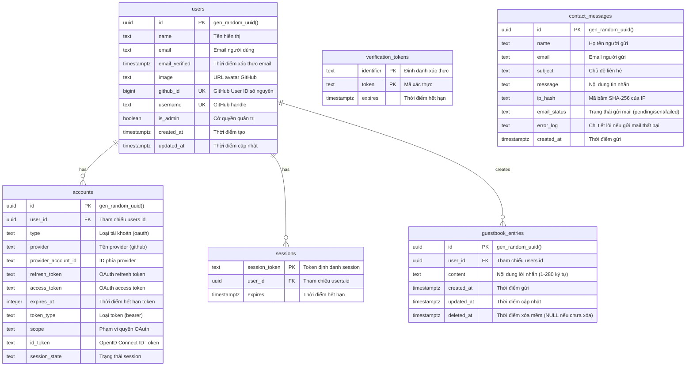

# Database - Thiết kế Cơ sở Dữ liệu Portfolio

Tài liệu này đặc tả chi tiết 100% cấu trúc cơ sở dữ liệu quan hệ (PostgreSQL) và cấu trúc dữ liệu bộ nhớ đệm (Upstash Redis) của hệ thống. Toàn bộ các bảng, trường dữ liệu, ràng buộc, chỉ mục (indexes) và quy tắc toàn vẹn dữ liệu được liệt kê đầy đủ, không sử dụng placeholder hoặc cú pháp tóm tắt.

---

## 1. Tổng quan Thiết kế

- **Hệ quản trị CSDL quan hệ:** PostgreSQL phiên bản 15+ (Lưu trữ trên nền tảng Supabase).
- **Hệ thống Cache & Key-Value:** Upstash Redis (Serverless).
- **Thư viện ánh xạ quan hệ (ORM):** Drizzle ORM (`drizzle-orm`) kết hợp Drizzle Kit (`drizzle-kit`).
- **Quy ước đặt tên (Naming Conventions):**
  - Tên bảng: Chữ thường, số nhiều, định dạng `snake_case` (ví dụ: `users`, `guestbook_entries`, `contact_messages`).
  - Tên cột: Chữ thường, định dạng `snake_case` (ví dụ: `created_at`, `user_id`, `is_admin`).
  - Khóa chính: Cột `id` kiểu dữ liệu UUID tự động sinh bằng hàm `gen_random_uuid()` của PostgreSQL (ngoại lệ: các bảng `accounts`, `sessions` tuân thủ đặc tả của Auth.js Adapter).
  - Khóa ngoại: Tên bảng số ít kết hợp `_id` (ví dụ: `user_id` tham chiếu tới `users.id`).
  - Thời gian: Định dạng `timestamp with time zone` (`timestamptz`), luôn lưu theo chuẩn UTC.

---

## 2. Sơ đồ Thực thể Quan hệ (Entity-Relationship Diagram)



---

## 3. Đặc tả Chi tiết Từng Bảng (Data Dictionary)

### 3.1. Bảng `users`
Lưu trữ thông tin người dùng được định danh khi đăng nhập thông qua GitHub OAuth. Bảng này tương thích với Drizzle Adapter của Auth.js và được mở rộng thêm các trường phục vụ định danh admin và tài khoản GitHub.

| Tên cột | Kiểu dữ liệu | Ràng buộc | Giá trị mặc định | Diễn giải |
| :--- | :--- | :--- | :--- | :--- |
| `id` | `uuid` | PRIMARY KEY | `gen_random_uuid()` | Khóa chính duy nhất của người dùng |
| `name` | `varchar(255)` | NULL | NULL | Tên hiển thị công khai lấy từ GitHub profile |
| `email` | `varchar(255)` | NULL | NULL | Email tài khoản (có thể NULL nếu GitHub để private) |
| `email_verified` | `timestamptz` | NULL | NULL | Thời điểm xác minh email (chuẩn Auth.js) |
| `image` | `text` | NULL | NULL | URL ảnh đại diện (avatar) từ GitHub |
| `github_id` | `bigint` | UNIQUE, NOT NULL | Không | ID số nguyên của user trên hệ thống GitHub |
| `username` | `varchar(100)` | UNIQUE, NOT NULL | Không | Tên tài khoản GitHub (ví dụ: `nqkhanh-dev`) |
| `is_admin` | `boolean` | NOT NULL | `false` | Cờ xác định quyền admin (phục vụ hiển thị nhanh) |
| `created_at` | `timestamptz` | NOT NULL | `CURRENT_TIMESTAMP` | Thời điểm bản ghi được tạo |
| `updated_at` | `timestamptz` | NOT NULL | `CURRENT_TIMESTAMP` | Thời điểm cập nhật thông tin lần cuối |

> **Lưu ý tích hợp Auth.js Drizzle Adapter:** Do bảng `users` có 2 trường mở rộng `github_id` và `username` mang ràng buộc `NOT NULL`, cấu hình GitHub Provider trong `src/lib/auth.ts` phải sử dụng callback `profile(profile)` để map trực tiếp `github_id` (từ `profile.id`) và `username` (từ `profile.login`), đảm bảo Drizzle Adapter không gặp lỗi thiếu trường bắt buộc khi người dùng đăng nhập lần đầu.

### 3.2. Bảng `accounts`
Quản lý liên kết tài khoản OAuth của người dùng với nhà cung cấp dịch vụ xác thực (GitHub Provider). Tuân thủ nghiêm ngặt schema của Auth.js.

| Tên cột | Kiểu dữ liệu | Ràng buộc | Giá trị mặc định | Diễn giải |
| :--- | :--- | :--- | :--- | :--- |
| `id` | `uuid` | PRIMARY KEY | `gen_random_uuid()` | Khóa chính của liên kết tài khoản |
| `user_id` | `uuid` | NOT NULL, FK -> `users(id)` ON DELETE CASCADE | Không | Mã định danh người dùng sở hữu tài khoản |
| `type` | `varchar(50)` | NOT NULL | Không | Loại tài khoản xác thực (thường là `oauth`) |
| `provider` | `varchar(50)` | NOT NULL | Không | Tên nhà cung cấp (cố định là `github`) |
| `provider_account_id` | `varchar(255)` | NOT NULL | Không | ID người dùng phía GitHub (dạng chuỗi) |
| `refresh_token` | `text` | NULL | NULL | Token làm mới phiên của GitHub OAuth |
| `access_token` | `text` | NULL | NULL | Token truy cập của GitHub OAuth |
| `expires_at` | `integer` | NULL | NULL | Thời điểm hết hạn của access token (epoch seconds) |
| `token_type` | `varchar(50)` | NULL | NULL | Loại token được cấp (ví dụ: `bearer`) |
| `scope` | `text` | NULL | NULL | Danh sách quyền được cấp (ví dụ: `read:user,user:email`) |
| `id_token` | `text` | NULL | NULL | OpenID Connect ID token nếu có |
| `session_state` | `text` | NULL | NULL | Trạng thái phiên OAuth |

- **Ràng buộc duy nhất phức hợp (Composite Unique Constraint):** `UNIQUE (provider, provider_account_id)`.

### 3.3. Bảng `sessions`
Lưu trữ các phiên làm việc đang hoạt động của người dùng trong trường hợp sử dụng Database Session Strategy.

| Tên cột | Kiểu dữ liệu | Ràng buộc | Giá trị mặc định | Diễn giải |
| :--- | :--- | :--- | :--- | :--- |
| `session_token` | `varchar(255)` | PRIMARY KEY | Không | Chuỗi token ngẫu nhiên định danh phiên đăng nhập |
| `user_id` | `uuid` | NOT NULL, FK -> `users(id)` ON DELETE CASCADE | Không | Người dùng sở hữu phiên đăng nhập |
| `expires` | `timestamptz` | NOT NULL | Không | Thời điểm hết hạn của phiên làm việc |

### 3.4. Bảng `verification_tokens`
Bảng phục vụ cơ chế tạo và kiểm tra token xác thực dùng một lần (Magic Link / Email Verification theo chuẩn Auth.js). Mặc dù dự án dùng OAuth là chính, bảng này bắt buộc phải có để đảm bảo adapter Auth.js không phát sinh lỗi khởi tạo.

| Tên cột | Kiểu dữ liệu | Ràng buộc | Giá trị mặc định | Diễn giải |
| :--- | :--- | :--- | :--- | :--- |
| `identifier` | `varchar(255)` | NOT NULL | Không | Định danh cần xác thực (ví dụ địa chỉ email) |
| `token` | `varchar(255)` | NOT NULL | Không | Mã token xác thực dùng một lần |
| `expires` | `timestamptz` | NOT NULL | Không | Thời điểm hết hạn của mã token |

- **Khóa chính phức hợp (Composite Primary Key):** `PRIMARY KEY (identifier, token)`.

### 3.5. Bảng `guestbook_entries`
Lưu trữ các lời nhắn của khách truy cập để lại trên trang Sổ lưu niệm (`/guestbook`).

| Tên cột | Kiểu dữ liệu | Ràng buộc | Giá trị mặc định | Diễn giải |
| :--- | :--- | :--- | :--- | :--- |
| `id` | `uuid` | PRIMARY KEY | `gen_random_uuid()` | Mã định danh duy nhất của lời nhắn |
| `user_id` | `uuid` | NOT NULL, FK -> `users(id)` ON DELETE RESTRICT | Không | Người dùng đã đăng nhập tạo ra lời nhắn |
| `content` | `varchar(280)` | NOT NULL | Không | Nội dung lời nhắn (đã trim, từ 1 đến 280 ký tự) |
| `created_at` | `timestamptz` | NOT NULL | `CURRENT_TIMESTAMP` | Thời điểm lời nhắn được gửi |
| `updated_at` | `timestamptz` | NOT NULL | `CURRENT_TIMESTAMP` | Thời điểm sửa đổi lời nhắn (nếu có) |
| `deleted_at` | `timestamptz` | NULL | NULL | Thời điểm xóa mềm. Nếu khác NULL, lời nhắn bị ẩn |

- **Ràng buộc kiểm tra (Check Constraint):** `CHECK (char_length(trim(content)) >= 1 AND char_length(content) <= 280)`.

### 3.6. Bảng `contact_messages`
Lưu trữ toàn bộ tin nhắn liên hệ gửi qua form tại trang `/contact`. Dữ liệu được lưu trữ độc lập để chủ trang không bao giờ bị mất liên hệ kể cả khi dịch vụ gửi email gặp sự cố.

| Tên cột | Kiểu dữ liệu | Ràng buộc | Giá trị mặc định | Diễn giải |
| :--- | :--- | :--- | :--- | :--- |
| `id` | `uuid` | PRIMARY KEY | `gen_random_uuid()` | Mã định danh duy nhất của tin nhắn liên hệ |
| `name` | `varchar(80)` | NOT NULL | Không | Họ tên của người liên hệ (2 đến 80 ký tự) |
| `email` | `varchar(254)` | NOT NULL | Không | Địa chỉ email để phản hồi |
| `subject` | `varchar(50)` | NOT NULL | Không | Chủ đề liên hệ (`job`, `project`, `feedback`, `other`) |
| `message` | `text` | NOT NULL | Không | Nội dung liên hệ chi tiết (20 đến 2000 ký tự) |
| `ip_hash` | `char(64)` | NOT NULL | Không | Mã băm SHA-256 (64 ký tự hex) của IP người gửi |
| `email_status` | `varchar(20)` | NOT NULL | `'pending'` | Trạng thái gửi mail: `pending`, `sent`, `failed` |
| `error_log` | `text` | NULL | NULL | Nhật ký lỗi trả về từ Resend nếu gửi thất bại |
| `created_at` | `timestamptz` | NOT NULL | `CURRENT_TIMESTAMP` | Thời điểm tin nhắn được gửi lên hệ thống |

- **Ràng buộc kiểm tra (Check Constraints):**
  - `CHECK (char_length(trim(name)) >= 2 AND char_length(name) <= 80)`
  - `CHECK (char_length(trim(message)) >= 20 AND char_length(message) <= 2000)`
  - `CHECK (subject IN ('job', 'project', 'feedback', 'other'))`
  - `CHECK (email_status IN ('pending', 'sent', 'failed'))`

---

## 4. Chiến lược Đánh Chỉ mục (Indexes Strategy)

Các chỉ mục B-Tree được thiết lập có chủ đích để tối ưu hiệu năng cho các câu truy vấn phổ biến nhất, đảm bảo thời gian phản hồi dưới 10ms trên tập dữ liệu hàng nghìn bản ghi:

| Tên Index | Bảng áp dụng | Cột đánh Index | Loại Index | Mục đích kỹ thuật |
| :--- | :--- | :--- | :--- | :--- |
| `idx_guestbook_active_created` | `guestbook_entries` | `(deleted_at, created_at DESC)` | B-Tree (Partial/Composite) | Tối ưu tuyệt đối cho phân trang danh sách Guestbook công khai (`WHERE deleted_at IS NULL ORDER BY created_at DESC LIMIT 20`) |
| `idx_guestbook_user_active` | `guestbook_entries` | `(user_id, deleted_at)` | B-Tree | Tối ưu kiểm tra quy tắc nghiệp vụ BR-03 (đếm tổng số lời nhắn còn hiệu lực của 1 user) |
| `idx_contact_rate_limit` | `contact_messages` | `(ip_hash, created_at DESC)` | B-Tree | Phục vụ kiểm tra lịch sử gửi tin của một IP hash làm phương án dự phòng khi Redis không khả dụng |
| `idx_users_github_id` | `users` | `github_id` | B-Tree (Unique) | Tìm kiếm user tức thời khi hoàn tất callback OAuth từ GitHub |
| `idx_accounts_user_id` | `accounts` | `user_id` | B-Tree | Tìm danh sách tài khoản liên kết theo người dùng |
| `idx_sessions_user_id` | `sessions` | `user_id` | B-Tree | Thu hồi hoặc truy vấn session theo người dùng |

---

## 5. Cấu trúc Dữ liệu trên Upstash Redis (Key-Value Schema)

Upstash Redis đóng vai trò tầng đệm dữ liệu tốc độ cao (In-memory storage) cho các bài toán phân tán, rate limiting và bộ đếm có tần suất ghi cao:

| Định dạng Key (Pattern) | Kiểu dữ liệu | TTL (Thời gian sống) | Mục đích sử dụng | Giá trị mẫu |
| :--- | :--- | :--- | :--- | :--- |
| `rl:guestbook:<user_id>` | Hash / Sorted Set | 600 giây (10 phút) | Giới hạn 3 lần gửi Guestbook trong 10 phút của một user | Quản lý bởi `@upstash/ratelimit` |
| `rl:contact:<ip_hash>` | Hash / Sorted Set | 3600 giây (1 giờ) | Giới hạn 3 lần gửi form Contact trong 1 giờ của một IP hash | Quản lý bởi `@upstash/ratelimit` |
| `rl:views:<ip_hash>` | Hash / Sorted Set | 60 giây (1 phút) | Giới hạn 30 request gọi API đếm view trong 1 phút | Quản lý bởi `@upstash/ratelimit` |
| `view_dedup:<slug>:<ip_hash>` | String | 86400 giây (24 giờ) | Chống đếm trùng lượt xem của một người đọc trong 24 giờ | `"1"` |
| `views:project:<slug>` | String (Integer) | Vô hạn (Persistent) | Lưu trữ tổng số lượt xem tích lũy của một Case Study dự án | `"1248"` (Tăng bằng lệnh `INCR`) |
| `cache:telemetry:github` | String (JSON) | 3600 giây (1 giờ) | Cache kết quả gọi GitHub GraphQL API (tránh chạm rate limit GitHub) | `{"contributions": 420, "events": [...]}` |

---

## 6. Kế hoạch Quản lý Migration và Khởi tạo Dữ liệu (Migration & Seeding)

### 6.1. Quy trình Quản lý Migration bằng Drizzle Kit

1. Toàn bộ định nghĩa schema chuẩn được viết tập trung tại tệp: `src/lib/db/schema.ts`.
2. Khi có sự thay đổi cấu trúc bảng, chạy lệnh:
   ```bash
   pnpm db:generate
   ```
   Drizzle Kit sẽ tự động so sánh `schema.ts` với snapshot hiện tại trong thư mục `drizzle/meta/` để sinh ra tệp migration SQL mới có đánh số thứ tự (ví dụ: `drizzle/0001_add_indexes.sql`).
3. Để áp dụng file migration lên cơ sở dữ liệu Supabase, chạy lệnh:
   ```bash
   pnpm db:migrate
   ```
4. **Quy tắc An toàn:**
   - Tuyệt đối không chỉnh sửa nội dung các tệp migration SQL đã được đẩy lên nhánh `main` hoặc môi trường Production.
   - Không chạy lệnh `drizzle-kit push` trên môi trường Production để tránh rủi ro mất dữ liệu ngầm; luôn thực thi migration thông qua các tệp SQL đã được version hóa trong Git.

### 6.2. Kịch bản Nạp Dữ liệu Mẫu (Seeding Script)

Kịch bản nạp dữ liệu mẫu được định nghĩa tại `scripts/seed.ts` và thực thi qua lệnh `pnpm db:seed`:
- Kiểm tra biến môi trường: Kịch bản sẽ tự động ngắt ngay lập tức nếu phát hiện `NODE_ENV === "production"` hoặc `VERCEL_ENV === "production"`.
- Thực hiện nạp 3 tài khoản người dùng thử nghiệm (`github_id` mang giá trị âm `-1001`, `-1002`, `-1003` để không bao giờ xung đột với ID thật của GitHub).
- Thực hiện nạp 6 lời nhắn mẫu vào bảng `guestbook_entries` với các mốc thời gian `created_at` lùi dần về quá khứ theo đúng đặc tả tại `docs/assets.md`.
