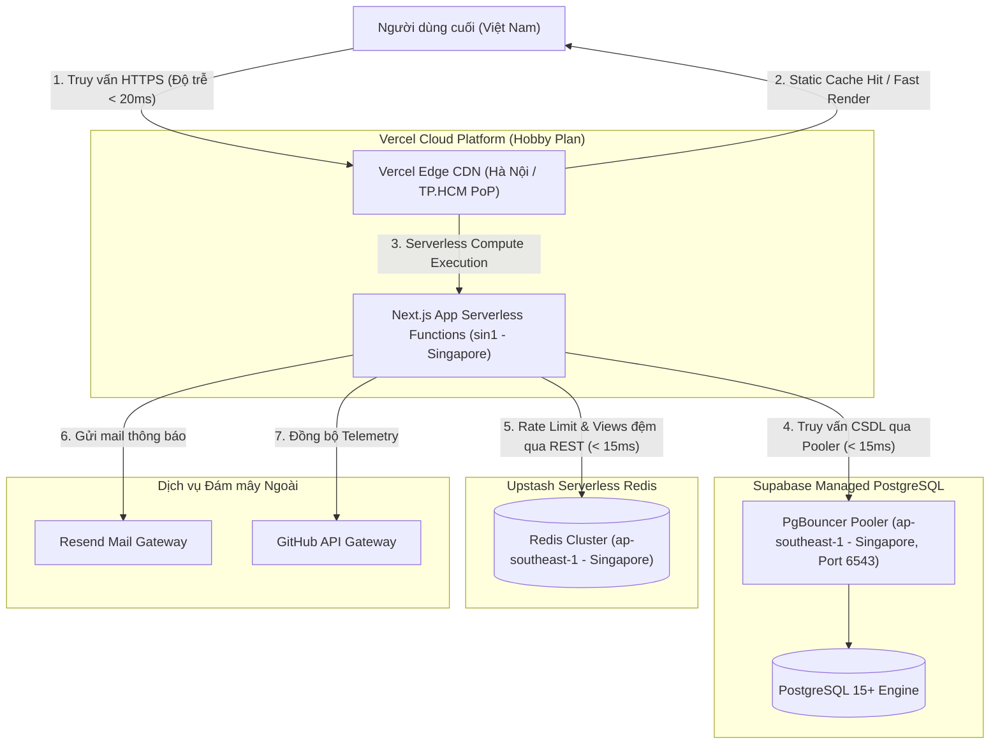

# Deploy - Hướng dẫn Triển khai Hệ thống Portfolio

Tài liệu này cung cấp hướng dẫn từng bước để triển khai toàn bộ hệ thống Portfolio lên môi trường Production trên các nền tảng đám mây hoàn toàn miễn phí (Free-tier), tối ưu hóa vị trí địa lý cho người dùng tại Việt Nam và đảm bảo hệ thống vận hành liên tục, ổn định 100%.

---

## 1. Kiến trúc Triển khai (Deployment Topology)



### Chiến lược Tối ưu Vị trí Địa lý (Region Optimization)
- Toàn bộ tài nguyên Serverless Compute (Vercel Functions), Cơ sở dữ liệu (Supabase) và Bộ nhớ đệm (Upstash Redis) đều được cấu hình đặt tại trung tâm dữ liệu **Singapore (`ap-southeast-1` / `sin1`)**.
- Vị trí này đảm bảo độ trễ mạng (Network Latency) giữa máy chủ ứng dụng và cơ sở dữ liệu luôn duy trì ở mức cực thấp (< 15ms), đồng thời mang lại tốc độ tải trang nhanh nhất cho người truy cập tại Việt Nam.

---

## 2. Hướng dẫn Thiết lập Từng bước (Step-by-Step Setup Guide)

### Bước 1: Khởi tạo Cơ sở Dữ liệu Supabase PostgreSQL
1. Truy cập https://supabase.com, đăng nhập bằng tài khoản GitHub và nhấn "New project".
2. **Cấu hình dự án:**
   - Name: `portfolio-db`
   - Database Password: Tạo mật khẩu an toàn dài ít nhất 16 ký tự và lưu vào trình quản lý mật khẩu.
   - Region: Chọn **Southeast Asia (Singapore) - `ap-southeast-1`**.
   - Pricing Plan: Chọn **Free Plan**.
3. **Lấy chuỗi kết nối (Connection Strings):**
   - Truy cập **Project Settings > Database**.
   - Kéo xuống mục **Connection string**:
     - Chọn tab **URI**, chế độ **Transaction** (Port `6543`): Lưu lại làm giá trị biến `DATABASE_URL`.
     - Chọn tab **URI**, chế độ **Session** hoặc kết nối trực tiếp (Port `5432`): Lưu lại làm giá trị biến `DATABASE_DIRECT_URL`.
4. **Thực thi Migration khởi tạo:**
   - Trên máy tính cá nhân, cấu hình biến `DATABASE_URL` trong file `.env.local` trỏ tới chuỗi kết nối vừa lấy.
   - Chạy lệnh để đẩy toàn bộ bảng và chỉ mục lên database:
     ```bash
     pnpm db:migrate
     ```

### Bước 2: Khởi tạo Bộ nhớ đệm Upstash Redis
1. Truy cập https://upstash.com, đăng nhập bằng tài khoản GitHub.
2. Tại màn hình điều khiển, nhấn **"Create Database"**.
3. **Cấu hình:**
   - Name: `portfolio-redis`
   - Type: **Regional**
   - Region: Chọn **ap-southeast-1 (Singapore)**.
   - Eviction: Bật tính năng eviction (hoặc giữ mặc định).
4. **Lấy thông tin xác thực:**
   - Tại trang chi tiết của database vừa tạo, kéo xuống mục **REST API**.
   - Sao chép giá trị của `UPSTASH_REDIS_REST_URL` và `UPSTASH_REDIS_REST_TOKEN`.

### Bước 3: Đăng ký GitHub OAuth Application
1. Truy cập GitHub, vào **Settings > Developer Settings > OAuth Apps > New OAuth App**.
2. **Cấu hình thông tin:**
   - Application name: `Portfolio`
   - Homepage URL: `https://yourdomain.com` (hoặc URL tạm thời của Vercel: `https://portfolio-dev.vercel.app`).
   - Authorization callback URL: `https://yourdomain.com/api/auth/callback/github` (hoặc `https://portfolio-dev.vercel.app/api/auth/callback/github`).
3. Nhấn **"Register application"**.
4. Sao chép **Client ID** (đây là `AUTH_GITHUB_ID`).
5. Nhấn **"Generate a new client secret"**, sao chép giá trị Secret vừa tạo (đây là `AUTH_GITHUB_SECRET`).

### Bước 4: Thiết lập Dịch vụ Gửi Email Resend
1. Truy cập https://resend.com, đăng nhập tài khoản.
2. Vào mục **API Keys**, nhấn **"Create API Key"**, đặt quyền Full access và sao chép khóa (đây là `RESEND_API_KEY`).
3. **Xác thực tên miền gửi email (Domain Verification):**
   - Vào mục **Domains > Add Domain**, nhập tên miền cá nhân của bạn (ví dụ: `nqkhanh.dev`).
   - Cấu hình các bản ghi DNS (MX, TXT, CNAME) theo hướng dẫn của Resend vào trang quản trị tên miền để hoàn tất xác minh.
   - *Phương án dự phòng:* Nếu chưa sở hữu tên miền riêng, Resend cho phép gửi email kiểm thử từ địa chỉ `onboarding@resend.dev` tới chính địa chỉ email bạn đã dùng để đăng ký tài khoản Resend.

### Bước 5: Tạo GitHub Personal Access Token (PAT)
1. Trên GitHub, vào **Settings > Developer Settings > Personal access tokens > Fine-grained tokens**.
2. Nhấn **"Generate new token"**:
   - Token name: `portfolio-telemetry-reader`
   - Expiration: Chọn thời hạn mong muốn (ví dụ 1 năm).
   - Repository access: **Public Repositories (read-only)**.
   - Permissions: Chỉ cấp quyền đọc cho User profile và công khai.
3. Sao chép chuỗi token tạo được (đây là `GITHUB_READ_TOKEN`).

### Bước 6: Triển khai Ứng dụng lên Vercel
1. Truy cập https://vercel.com, chọn **"Add New... > Project"**.
2. Tìm và chọn repository `portfolio` từ danh sách GitHub của bạn, nhấn **"Import"**.
3. **Cấu hình Project Settings:**
   - Framework Preset: **Next.js** (Vercel tự động nhận diện).
   - Root Directory: `./`
   - Build Command: `pnpm build`
   - Install Command: `pnpm install --frozen-lockfile`
   - Output Directory: `.next`
4. **Cấu hình Biến Môi trường (Environment Variables):**
   - Thêm đầy đủ 100% các biến môi trường sau vào mục **Environment Variables** (chọn áp dụng cho cả `Production` và `Preview`):

| Tên biến | Giá trị cấu hình |
| :--- | :--- |
| `DATABASE_URL` | Chuỗi kết nối Supabase Pooler (Port 6543) |
| `DATABASE_DIRECT_URL` | Chuỗi kết nối Supabase Direct (Port 5432) |
| `AUTH_SECRET` | Sinh chuỗi ngẫu nhiên 32 ký tự bằng lệnh: `openssl rand -base64 32` |
| `AUTH_URL` | `https://yourdomain.com` (hoặc URL Vercel) |
| `AUTH_GITHUB_ID` | Client ID lấy từ Bước 3 |
| `AUTH_GITHUB_SECRET` | Client Secret lấy từ Bước 3 |
| `ADMIN_GITHUB_ID` | ID số tài khoản GitHub của bạn |
| `UPSTASH_REDIS_REST_URL` | REST URL lấy từ Bước 2 |
| `UPSTASH_REDIS_REST_TOKEN` | REST Token lấy từ Bước 2 |
| `HASH_SALT` | Chuỗi ngẫu nhiên 32 ký tự bằng lệnh: `openssl rand -hex 16` |
| `VIEW_SALT` | Chuỗi ngẫu nhiên 32 ký tự bằng lệnh: `openssl rand -hex 16` |
| `HMAC_SECRET` | Chuỗi ngẫu nhiên 32 ký tự bằng lệnh: `openssl rand -hex 16` |
| `RESEND_API_KEY` | API Key lấy từ Bước 4 |
| `NOTIFICATION_EMAIL` | Địa chỉ email của bạn để nhận thông báo |
| `GITHUB_READ_TOKEN` | Token lấy từ Bước 5 |
| `NEXT_PUBLIC_SITE_URL` | `https://yourdomain.com` (hoặc URL Vercel) |

5. Nhấn **"Deploy"**. Quá trình build và đóng gói sẽ hoàn tất trong khoảng 1 đến 2 phút.

---

## 3. Chiến lược Chống Tạm dừng Cơ sở dữ liệu Supabase Free-tier (Pause Prevention Strategy)

### Vấn đề Kỹ thuật
Theo chính sách của Supabase đối với gói Free-tier, nếu một dự án không phát sinh bất kỳ yêu cầu truy vấn API hay kết nối cơ sở dữ liệu nào trong vòng **7 ngày liên tục**, dự án sẽ bị chuyển sang trạng thái tạm dừng (Paused). Khi đó, các tính năng Guestbook và Contact sẽ gặp lỗi kết nối.

### Giải pháp Khắc phục Tự động
Thiết lập một quy trình tự động (Scheduled GitHub Action) chạy định kỳ **3 ngày một lần** vào lúc 00:00 UTC để gửi một request HTTP nhẹ tới endpoint đọc dữ liệu công khai của hệ thống, giúp cơ sở dữ liệu luôn được kích hoạt:

Tạo tệp `.github/workflows/keepalive.yml`:

```yaml
name: Supabase Keepalive Ping

on:
  schedule:
    # Chạy vào 00:00 UTC các ngày Thứ 2, Thứ 4, Thứ 7 hàng tuần
    - cron: '0 0 * * 1,3,6'
  workflow_dispatch: # Cho phép kích hoạt thủ công khi cần kiểm tra

jobs:
  ping-keepalive:
    name: Ping Database Endpoint
    runs-on: ubuntu-latest
    steps:
      - name: Send HTTP Ping Request
        run: |
          curl -f -s -o /dev/null -w "HTTP Response Code: %{http_code}\n" https://yourdomain.com/api/views/portfolio || exit 1
```

---

## 4. Cấu hình Tên miền Tùy chỉnh (Custom Domain Setup)

1. Mua hoặc sử dụng tên miền có sẵn (ví dụ từ Namecheap, Cloudflare, hoặc Tenten).
2. Tại Vercel Dashboard, vào **Project Settings > Domains**.
3. Nhập tên miền mong muốn (ví dụ `nqkhanh.dev` và `www.nqkhanh.dev`), nhấn **"Add"**.
4. Truy cập trang quản trị DNS của nhà cung cấp tên miền, thêm 2 bản ghi sau:

| Loại bản ghi (Type) | Tên bản ghi (Name) | Giá trị trỏ đến (Value) | TTL |
| :--- | :--- | :--- | :--- |
| `A` | `@` | `76.76.21.21` | Tự động hoặc 3600 |
| `CNAME` | `www` | `cname.vercel-dns.com.` | Tự động hoặc 3600 |

5. Vercel sẽ tự động xác minh bản ghi DNS và cấp phát chứng chỉ bảo mật SSL (Let's Encrypt) miễn phí trong vòng vài phút.
6. Sau khi tên miền hoạt động, quay lại **GitHub Developer Settings > OAuth Apps** để cập nhật lại `Homepage URL` và `Authorization callback URL` sang tên miền mới.

---

## 5. Quy trình Kiểm thử Khói sau Triển khai (Post-deployment Smoke Testing)

Ngay sau khi quá trình triển khai hoàn tất, thực hiện tuần tự danh sách kiểm tra nhanh 8 bước sau để đảm bảo mọi chức năng vận hành chính xác:

- [ ] **1. Kiểm tra Trang chủ:** Tải trang dưới 1 giây, ảnh avatar hiển thị rõ ràng, không xuất hiện thông báo lỗi trong DevTools Console.
- [ ] **2. Kiểm tra Command Palette:** Nhấn `Ctrl + K` (hoặc `Cmd + K`), kiểm tra khả năng tìm kiếm và thử chuyển đổi giao diện Dark/Light.
- [ ] **3. Kiểm tra Tải CV:** Bấm nút "Tải CV", kiểm tra file PDF tải về có đúng định dạng và đọc được chữ.
- [ ] **4. Kiểm tra Chi tiết Dự án:** Mở trang Case Study `/projects/portfolio`, kiểm tra bộ đếm lượt xem có hiển thị số và tăng lên chính xác.
- [ ] **5. Kiểm tra Đăng nhập Guestbook:** Bấm "Đăng nhập bằng GitHub", ủy quyền thành công và quay lại trang với đầy đủ avatar và tên người dùng.
- [ ] **6. Kiểm tra Gửi Lời nhắn Guestbook:** Nhập nội dung, kiểm tra Optimistic UI hiển thị ngay lập tức, sau đó reload trang xem dữ liệu có lưu bền vững trong Supabase không.
- [ ] **7. Kiểm tra Gửi Form Liên hệ:** Điền form tại `/contact`, gửi thành công và kiểm tra hộp thư email cá nhân xem có nhận được thông báo từ Resend không.
- [ ] **8. Kiểm tra Google Lighthouse:** Mở tab DevTools Lighthouse, chạy kiểm tra trên Mobile với cả 4 hạng mục (Performance, Accessibility, Best Practices, SEO) để xác nhận đạt điểm từ 95 trở lên.
