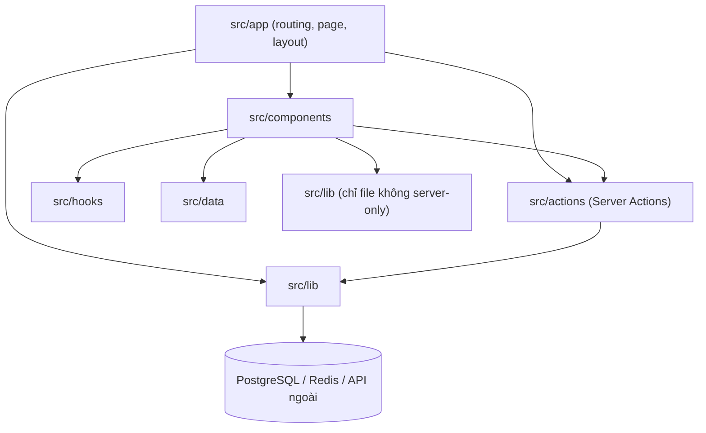

# Folder Structure - Cấu trúc thư mục dự án

Tài liệu mô tả toàn bộ cây thư mục (skeleton) của dự án và trách nhiệm từng file. Agent hoặc developer khi tạo file mới phải đặt đúng vị trí theo tài liệu này; nếu cần thêm file ngoài danh sách, cập nhật tài liệu trước.

---

## 1. Nguyên tắc tổ chức

| Nguyên tắc | Quy định |
| :--- | :--- |
| Mã nguồn trong `src/` | Toàn bộ code TypeScript nằm trong `src/`; cấu hình công cụ nằm ở thư mục gốc. |
| `app/` chỉ chứa routing | File trong `src/app/` chỉ làm nhiệm vụ route, layout, metadata và ghép component. Logic nghiệp vụ nằm trong `src/lib/` hoặc `src/actions/`. |
| Phân tầng | `app` (route) -> `components` (UI) -> `actions` (Server Actions) -> `lib` (nghiệp vụ, truy cập dữ liệu, tích hợp ngoài). Tầng dưới không import tầng trên. |
| Server-only | File truy cập database, Redis, secret phải có `import "server-only";` ở dòng đầu để build báo lỗi nếu bị import vào Client Component. |
| Client Component tối thiểu | Chỉ thêm `"use client"` cho component cần state, effect, event handler hoặc API trình duyệt. |
| Đặt tên | File và thư mục: `kebab-case`. Component React: export `PascalCase`. Hook: tiền tố `use-`. |
| Alias import | `@/*` trỏ tới `src/*` (cấu hình trong `tsconfig.json`). |
| Không barrel file | Không tạo `index.ts` re-export hàng loạt trong `components/` để tránh tăng bundle và vòng phụ thuộc. Ngoại lệ: `src/lib/db/index.ts`. |

---

## 2. Cây thư mục đầy đủ

```
portfolio/
├── .github/
│   ├── workflows/
│   │   └── ci.yml
│   ├── ISSUE_TEMPLATE/
│   │   ├── bug_report.md
│   │   └── feature_request.md
│   └── pull_request_template.md
├── .vscode/
│   ├── extensions.json
│   └── settings.json
├── content/
│   └── projects/
│       ├── portfolio.mdx
│       ├── taskflow.mdx
│       └── shoplite.mdx
├── docs/
│   ├── product.md
│   ├── spec.md
│   ├── design-system.md
│   ├── assets.md
│   ├── folder-structure.md
│   ├── architecture.md
│   ├── database.md
│   ├── api.md
│   ├── git-workflow.md
│   ├── github-setup.md
│   ├── deploy.md
│   ├── roadmap.md
│   └── worklog.md
├── drizzle/
│   ├── 0000_initial.sql
│   └── meta/
│       ├── _journal.json
│       └── 0000_snapshot.json
├── public/
│   ├── icons/
│   │   ├── social/
│   │   │   ├── github.svg
│   │   │   └── linkedin.svg
│   │   └── tech/
│   │       ├── css.svg
│   │       ├── docker.svg
│   │       ├── drizzle.svg
│   │       ├── express.svg
│   │       ├── figma.svg
│   │       ├── git.svg
│   │       ├── github-actions.svg
│   │       ├── html5.svg
│   │       ├── javascript.svg
│   │       ├── mongodb.svg
│   │       ├── nextjs.svg
│   │       ├── nodejs.svg
│   │       ├── postgresql.svg
│   │       ├── prisma.svg
│   │       ├── react.svg
│   │       ├── redis.svg
│   │       ├── supabase.svg
│   │       ├── tailwindcss.svg
│   │       ├── typescript.svg
│   │       ├── vercel.svg
│   │       └── vitest.svg
│   ├── images/
│   │   ├── avatar.jpg
│   │   ├── grid-dot.svg
│   │   └── projects/
│   │       ├── portfolio/
│   │       │   ├── architecture.svg
│   │       │   └── cover.png
│   │       ├── shoplite/
│   │       │   ├── architecture.svg
│   │       │   └── cover.png
│   │       └── taskflow/
│   │           ├── architecture.svg
│   │           └── cover.png
│   └── resume.pdf
├── scripts/
│   ├── seed.ts
│   └── validate-content.ts
├── src/
│   ├── actions/
│   │   ├── contact.ts
│   │   └── guestbook.ts
│   ├── app/
│   │   ├── api/
│   │   │   ├── auth/
│   │   │   │   └── [...nextauth]/
│   │   │   │       └── route.ts
│   │   │   ├── telemetry/
│   │   │   │   └── route.ts
│   │   │   └── views/
│   │   │       └── [slug]/
│   │   │           └── route.ts
│   │   ├── contact/
│   │   │   └── page.tsx
│   │   ├── guestbook/
│   │   │   ├── loading.tsx
│   │   │   └── page.tsx
│   │   ├── lab/
│   │   │   └── page.tsx
│   │   ├── projects/
│   │   │   ├── [slug]/
│   │   │   │   ├── opengraph-image.tsx
│   │   │   │   └── page.tsx
│   │   │   └── page.tsx
│   │   ├── apple-icon.png
│   │   ├── error.tsx
│   │   ├── favicon.ico
│   │   ├── global-error.tsx
│   │   ├── globals.css
│   │   ├── icon.svg
│   │   ├── layout.tsx
│   │   ├── loading.tsx
│   │   ├── not-found.tsx
│   │   ├── opengraph-image.tsx
│   │   ├── page.tsx
│   │   ├── robots.ts
│   │   └── sitemap.ts
│   ├── assets/
│   │   └── fonts/
│   │       ├── Inter-Bold.ttf
│   │       └── Inter-SemiBold.ttf
│   ├── components/
│   │   ├── command-palette/
│   │   │   ├── command-items.ts
│   │   │   ├── command-palette.tsx
│   │   │   └── command-trigger.tsx
│   │   ├── contact/
│   │   │   ├── contact-channels.tsx
│   │   │   └── contact-form.tsx
│   │   ├── guestbook/
│   │   │   ├── delete-entry-dialog.tsx
│   │   │   ├── guestbook-entry.tsx
│   │   │   ├── guestbook-form.tsx
│   │   │   ├── guestbook-list.tsx
│   │   │   ├── sign-in-button.tsx
│   │   │   └── sign-out-button.tsx
│   │   ├── home/
│   │   │   ├── about-section.tsx
│   │   │   ├── experience-timeline.tsx
│   │   │   ├── featured-projects.tsx
│   │   │   ├── hero.tsx
│   │   │   ├── skill-group.tsx
│   │   │   ├── skills-section.tsx
│   │   │   └── timeline-item.tsx
│   │   ├── lab/
│   │   │   ├── demos/
│   │   │   │   ├── button-demo.tsx
│   │   │   │   ├── tabs-demo.tsx
│   │   │   │   └── toast-demo.tsx
│   │   │   ├── a11y-notes.tsx
│   │   │   ├── code-preview.tsx
│   │   │   ├── component-playground.tsx
│   │   │   └── props-panel.tsx
│   │   ├── layout/
│   │   │   ├── container.tsx
│   │   │   ├── mobile-nav.tsx
│   │   │   ├── reveal.tsx
│   │   │   ├── section-heading.tsx
│   │   │   ├── site-footer.tsx
│   │   │   ├── site-header.tsx
│   │   │   └── skip-link.tsx
│   │   ├── mdx/
│   │   │   ├── architecture-diagram.tsx
│   │   │   ├── callout.tsx
│   │   │   ├── code-block.tsx
│   │   │   ├── mdx-components.tsx
│   │   │   ├── mdx-image.tsx
│   │   │   └── metric.tsx
│   │   ├── projects/
│   │   │   ├── case-study-header.tsx
│   │   │   ├── project-card.tsx
│   │   │   ├── project-filter.tsx
│   │   │   ├── project-grid.tsx
│   │   │   ├── project-pager.tsx
│   │   │   ├── table-of-contents.tsx
│   │   │   ├── tech-badge.tsx
│   │   │   └── view-counter.tsx
│   │   ├── telemetry/
│   │   │   ├── deploy-info.tsx
│   │   │   ├── github-activity-list.tsx
│   │   │   └── telemetry-widget.tsx
│   │   ├── theme/
│   │   │   ├── theme-provider.tsx
│   │   │   ├── theme-script.tsx
│   │   │   └── theme-toggle.tsx
│   │   └── ui/
│   │       ├── avatar.tsx
│   │       ├── badge.tsx
│   │       ├── button.tsx
│   │       ├── card.tsx
│   │       ├── chip.tsx
│   │       ├── copy-button.tsx
│   │       ├── dialog.tsx
│   │       ├── dropdown-menu.tsx
│   │       ├── empty-state.tsx
│   │       ├── error-state.tsx
│   │       ├── field-error.tsx
│   │       ├── icon-button.tsx
│   │       ├── input.tsx
│   │       ├── kbd.tsx
│   │       ├── label.tsx
│   │       ├── select.tsx
│   │       ├── sheet.tsx
│   │       ├── skeleton.tsx
│   │       ├── spinner.tsx
│   │       ├── tabs.tsx
│   │       ├── textarea.tsx
│   │       ├── toast.tsx
│   │       └── tooltip.tsx
│   ├── data/
│   │   ├── experience.ts
│   │   ├── lab-components.ts
│   │   ├── profile.ts
│   │   └── skills.ts
│   ├── hooks/
│   │   ├── use-copy-to-clipboard.ts
│   │   ├── use-keyboard-shortcut.ts
│   │   ├── use-media-query.ts
│   │   └── use-url-state.ts
│   ├── lib/
│   │   ├── db/
│   │   │   ├── index.ts
│   │   │   ├── queries/
│   │   │   │   ├── contact.ts
│   │   │   │   ├── guestbook.ts
│   │   │   │   └── users.ts
│   │   │   └── schema.ts
│   │   ├── validations/
│   │   │   ├── contact.ts
│   │   │   ├── guestbook.ts
│   │   │   └── project-frontmatter.ts
│   │   ├── action-result.ts
│   │   ├── auth.ts
│   │   ├── constants.ts
│   │   ├── crypto.ts
│   │   ├── date.ts
│   │   ├── email.ts
│   │   ├── env.ts
│   │   ├── github.ts
│   │   ├── mdx.ts
│   │   ├── moderation.ts
│   │   ├── rate-limit.ts
│   │   ├── redis.ts
│   │   ├── site-config.ts
│   │   ├── utils.ts
│   │   └── views.ts
│   ├── types/
│   │   ├── index.ts
│   │   └── next-auth.d.ts
│   └── middleware.ts
├── tests/
│   ├── e2e/
│   │   ├── command-palette.spec.ts
│   │   ├── contact.spec.ts
│   │   ├── guestbook.spec.ts
│   │   ├── navigation.spec.ts
│   │   └── projects-filter.spec.ts
│   ├── setup/
│   │   └── vitest.setup.ts
│   └── unit/
│       ├── crypto.test.ts
│       ├── date.test.ts
│       ├── mdx.test.ts
│       ├── moderation.test.ts
│       ├── rate-limit.test.ts
│       └── validations/
│           ├── contact.test.ts
│           ├── guestbook.test.ts
│           └── project-frontmatter.test.ts
├── .editorconfig
├── .env.example
├── .gitignore
├── .nvmrc
├── .prettierignore
├── .prettierrc
├── LICENSE
├── README.md
├── drizzle.config.ts
├── eslint.config.mjs
├── next.config.ts
├── package.json
├── playwright.config.ts
├── pnpm-lock.yaml
├── postcss.config.mjs
├── tsconfig.json
└── vitest.config.ts
```

> Nếu phiên bản Tailwind CSS được chọn lúc khởi tạo vẫn dùng file cấu hình JavaScript, thêm `tailwind.config.ts` ở thư mục gốc. Với Tailwind CSS v4 trở lên, token được khai báo trực tiếp trong `src/app/globals.css` bằng `@theme` và không cần file này. Kiểm tra tài liệu chính thức khi khởi tạo.

---

## 3. Trách nhiệm từng thư mục và file

### 3.1. Thư mục gốc

| File | Trách nhiệm |
| :--- | :--- |
| `.editorconfig` | Thống nhất indent 2 space, LF, UTF-8 giữa các editor. |
| `.env.example` | Danh sách biến môi trường với giá trị mẫu, không chứa secret thật (chi tiết `github-setup.md`). |
| `.gitignore` | Loại trừ `node_modules`, `.next`, `.env*.local`, `coverage`, `test-results`, `playwright-report`. |
| `.nvmrc` | Phiên bản Node.js LTS dự án dùng. |
| `.prettierrc`, `.prettierignore` | Cấu hình format code, kèm plugin sắp xếp class Tailwind. |
| `LICENSE` | Giấy phép MIT cho mã nguồn. |
| `README.md` | Tổng quan và khởi chạy nhanh. |
| `drizzle.config.ts` | Cấu hình drizzle-kit: đường dẫn schema `src/lib/db/schema.ts`, thư mục migration `drizzle/`, dialect `postgresql`, đọc `DATABASE_URL`. |
| `eslint.config.mjs` | ESLint flat config: rule của Next.js, TypeScript strict, cấm `any`, cấm `console.log` (cho phép `console.error`, `console.warn`), plugin `jsx-a11y`. |
| `next.config.ts` | Security headers (NFR-09), cấu hình `images.remotePatterns` cho `avatars.githubusercontent.com`, bật `typedRoutes` nếu ổn định. |
| `package.json` | Dependency và script (danh sách script ở `README.md` mục 5). |
| `playwright.config.ts` | Cấu hình E2E: chạy `pnpm build && pnpm start` làm webServer, project Chromium và WebKit mobile (iPhone). |
| `postcss.config.mjs` | Nạp plugin PostCSS của Tailwind. |
| `tsconfig.json` | `strict: true`, `noUncheckedIndexedAccess: true`, alias `@/*`. |
| `vitest.config.ts` | Môi trường `jsdom` cho test component, `node` cho test lib; alias `@/*`; file setup ở `tests/setup/`. |

### 3.2. `.github/`

| File | Trách nhiệm |
| :--- | :--- |
| `workflows/ci.yml` | Chạy trên Pull Request và push vào `main`: cài dependency, lint, typecheck, unit test, validate content, build, E2E. |
| `ISSUE_TEMPLATE/bug_report.md` | Mẫu báo lỗi: mô tả, bước tái hiện, kết quả mong đợi, kết quả thực tế, môi trường. |
| `ISSUE_TEMPLATE/feature_request.md` | Mẫu đề xuất tính năng: vấn đề, giải pháp đề xuất, tiêu chí nghiệm thu. |
| `pull_request_template.md` | Checklist PR: mã TASK liên quan, mô tả thay đổi, ảnh chụp UI, đã chạy test, đã kiểm tra mobile và bàn phím. |

### 3.3. `.vscode/`

| File | Trách nhiệm |
| :--- | :--- |
| `extensions.json` | Gợi ý extension: ESLint, Prettier, Tailwind CSS IntelliSense, MDX. |
| `settings.json` | Format on save, dùng TypeScript của workspace. |

### 3.4. `content/projects/`

Mỗi file `.mdx` là một Case Study. Tên file chính là `slug` trên URL. Frontmatter theo schema ở `assets.md` mục 6.5. Thêm dự án mới chỉ cần thêm file tại đây và ảnh tại `public/images/projects/<slug>/`.

### 3.5. `docs/`

14 file tài liệu đặc tả (xem `README.md` mục 6). `README.md` nằm ở thư mục gốc.

### 3.6. `drizzle/`

Do `drizzle-kit generate` sinh ra, **không sửa tay** file SQL đã được áp dụng lên Production. Muốn thay đổi schema: sửa `schema.ts`, sinh migration mới.

### 3.7. `public/`

Tài nguyên tĩnh phục vụ trực tiếp. Danh sách và yêu cầu từng file ở `assets.md`.

### 3.8. `scripts/`

| File | Trách nhiệm |
| :--- | :--- |
| `seed.ts` | Nạp dữ liệu mẫu Guestbook (`assets.md` mục 6.7). Thoát với lỗi nếu `NODE_ENV=production` hoặc `VERCEL_ENV=production`. Chạy bằng `pnpm db:seed` (dùng `tsx`). |
| `validate-content.ts` | Đọc toàn bộ file MDX, validate frontmatter bằng Zod, kiểm tra đủ 6 heading bắt buộc (FR-04-03), kiểm tra file ảnh `cover` tồn tại, kiểm tra `order` không trùng, kiểm tra slug trong `tech` có trong `TECH_REGISTRY`. Chạy trong CI. |

### 3.9. `src/app/` - Routing

| File | Loại | Trách nhiệm |
| :--- | :--- | :--- |
| `layout.tsx` | Server | HTML gốc `lang="vi"`, nạp font, `ThemeScript`, `ThemeProvider`, `SkipLink`, `SiteHeader`, `<main id="main-content">`, `SiteFooter`, `CommandPalette`, `Toaster`, metadata mặc định, JSON-LD `Person` cho toàn site. |
| `page.tsx` | Server | Trang chủ: ghép `Hero`, `AboutSection`, `SkillsSection`, `FeaturedProjects`, `ExperienceTimeline`, `TelemetryWidget`. |
| `globals.css` | CSS | Import Tailwind, khai báo design token (Light trên `:root`, Dark trên `.dark`), style nền cho `body`, `:focus-visible`, `prefers-reduced-motion`. |
| `loading.tsx` | Server | Skeleton chung khi chuyển route. |
| `error.tsx` | Client | Error boundary cấp route (FR-13-02). |
| `global-error.tsx` | Client | Error boundary khi chính `layout.tsx` lỗi; tự render `<html>` và `<body>`. |
| `not-found.tsx` | Server | Trang 404 (FR-13-01). |
| `opengraph-image.tsx` | Server | OG image mặc định (`assets.md` mục 2.2). |
| `robots.ts` | Server | Sinh `robots.txt` (FR-12-04). |
| `sitemap.ts` | Server | Sinh `sitemap.xml` từ route tĩnh và danh sách dự án (FR-12-03). |
| `icon.svg`, `favicon.ico`, `apple-icon.png` | Tĩnh | Icon ứng dụng theo quy ước tên file của Next.js. |
| `projects/page.tsx` | Server | Đọc danh sách dự án, truyền xuống `ProjectFilter` và `ProjectGrid` (Client) để lọc. |
| `projects/[slug]/page.tsx` | Server | `generateStaticParams`, `generateMetadata`, render MDX, `CaseStudyHeader`, `TableOfContents`, `ProjectPager`, `ViewCounter`; gọi `notFound()` khi slug không hợp lệ. |
| `projects/[slug]/opengraph-image.tsx` | Server | OG image riêng cho từng Case Study. |
| `lab/page.tsx` | Server | Khung trang Lab, render `ComponentPlayground` (Client). |
| `guestbook/page.tsx` | Server (dynamic) | Đọc session, lấy trang đầu danh sách lời nhắn, render form hoặc nút đăng nhập. |
| `guestbook/loading.tsx` | Server | Skeleton danh sách Guestbook. |
| `contact/page.tsx` | Server | Render `ContactForm` (kèm timestamp đã ký cho BR-09) và `ContactChannels`. |
| `api/auth/[...nextauth]/route.ts` | Route Handler | Re-export `GET`, `POST` từ `lib/auth.ts`. |
| `api/views/[slug]/route.ts` | Route Handler | `GET`: đọc lượt xem; `POST`: tăng lượt xem có chống trùng và rate limit. |
| `api/telemetry/route.ts` | Route Handler | Gọi `lib/github.ts`, trả dữ liệu đã chuẩn hóa, `revalidate = 3600`. |

### 3.10. `src/middleware.ts`

Chỉ làm một việc: sinh `nonce` cho Content-Security-Policy (nếu dùng CSP có nonce) và gắn header. Không kiểm tra auth tại middleware vì không có route nào bị chặn hoàn toàn; kiểm tra quyền thực hiện trong Server Action. Nếu chọn CSP tĩnh trong `next.config.ts` thì xóa file này và ghi lại quyết định vào Decision Log.

### 3.11. `src/actions/` - Server Actions

| File | Trách nhiệm |
| :--- | :--- |
| `guestbook.ts` | `createEntry`, `deleteEntry`, `loadMoreEntries`. Thứ tự xử lý: kiểm tra session -> validate Zod -> kiểm tra từ khóa chặn -> rate limit -> gọi `lib/db/queries/guestbook.ts` -> `revalidateTag`. Trả về `ActionResult`. |
| `contact.ts` | `sendContactMessage`. Thứ tự: honeypot và thời gian điền -> rate limit theo IP hash -> validate Zod -> lưu DB -> gửi email -> cập nhật `email_status`. Trả về `ActionResult`. |

Mọi file có `"use server";` ở dòng đầu. Không bao giờ tin dữ liệu từ client, kể cả ID người dùng (luôn lấy từ session).

### 3.12. `src/components/`

| Thư mục | Trách nhiệm |
| :--- | :--- |
| `ui/` | Primitive UI tự viết, không chứa logic nghiệp vụ, không gọi API. Danh sách và props ở `design-system.md` mục 7.1. Đây cũng là các component được trưng bày trong Lab. |
| `layout/` | Khung trang. `reveal.tsx` là wrapper Client dùng Motion để fade-in khi vào viewport, tôn trọng reduced motion. |
| `home/` | Các section của trang chủ. Phần lớn là Server Component, đọc dữ liệu từ `src/data/`. |
| `projects/` | Hiển thị dự án. `project-filter.tsx`, `project-grid.tsx`, `table-of-contents.tsx`, `view-counter.tsx` là Client Component; còn lại là Server Component. |
| `mdx/` | Component dùng bên trong nội dung MDX. `mdx-components.tsx` khai báo bảng ánh xạ thẻ Markdown (`h2`, `a`, `img`, `pre`) và component tùy biến. |
| `command-palette/` | `command-palette.tsx` (Client, dùng `cmdk`); `command-items.ts` định nghĩa danh sách lệnh tĩnh (`assets.md` mục 6.10); danh sách dự án được truyền từ `layout.tsx` xuống dạng props. |
| `theme/` | `theme-script.tsx` chèn script inline chống nháy theme (FR-07-03); `theme-provider.tsx` quản lý state theme và lắng nghe `prefers-color-scheme`; `theme-toggle.tsx` là dropdown 3 lựa chọn. |
| `guestbook/` | Form dùng `useActionState` và `useOptimistic`; danh sách có nút "Xem thêm". |
| `contact/` | Form liên hệ và các kênh liên hệ trực tiếp. |
| `lab/` | `component-playground.tsx` quản lý component đang chọn và props (đồng bộ URL qua `use-url-state`); `props-panel.tsx` render control theo cấu hình ở `src/data/lab-components.ts`; `code-preview.tsx` sinh chuỗi JSX từ props; `demos/` bọc từng primitive UI. |
| `telemetry/` | `telemetry-widget.tsx` (Client) gọi `/api/telemetry`; `deploy-info.tsx` (Server) đọc commit SHA và thời điểm build. |

### 3.13. `src/data/`

Dữ liệu tĩnh, có kiểu TypeScript, không chứa logic. Nội dung ở `assets.md` mục 6.2 đến 6.4 và 6.9.

| File | Trách nhiệm |
| :--- | :--- |
| `profile.ts` | Đoạn giới thiệu và thông tin nhanh. |
| `skills.ts` | Danh sách kỹ năng theo nhóm, kèm `proof`. |
| `experience.ts` | Dòng thời gian học vấn, kinh nghiệm, giải thưởng. |
| `lab-components.ts` | Cấu hình props cho từng component trong Lab: tên, kiểu control, giá trị mặc định, tập giá trị hợp lệ. |

### 3.14. `src/hooks/`

| File | Trách nhiệm |
| :--- | :--- |
| `use-copy-to-clipboard.ts` | Ghi clipboard, trả về trạng thái `copied` trong 2 giây và lỗi nếu API không khả dụng. |
| `use-keyboard-shortcut.ts` | Đăng ký phím tắt toàn cục, nhận biết `Ctrl` hoặc `Cmd` theo hệ điều hành. |
| `use-media-query.ts` | Theo dõi media query (breakpoint, `prefers-reduced-motion`). |
| `use-url-state.ts` | Đồng bộ state với URL query qua `useSearchParams` và `router.replace` (không thêm history entry), có hàm parse an toàn trả về giá trị mặc định khi không hợp lệ. |

### 3.15. `src/lib/`

| File | Server-only | Trách nhiệm |
| :--- | :--- | :--- |
| `db/index.ts` | Có | Khởi tạo kết nối PostgreSQL và instance Drizzle; dùng connection string pooler phù hợp môi trường serverless (chi tiết `architecture.md`). |
| `db/schema.ts` | Có | Định nghĩa bảng Drizzle: `users`, `accounts`, `sessions`, `verification_tokens` (theo adapter Auth.js), `guestbook_entries`, `contact_messages` (chi tiết `database.md`). |
| `db/queries/users.ts` | Có | Truy vấn user (lấy theo ID, kiểm tra admin). |
| `db/queries/guestbook.ts` | Có | `listEntries(cursor, limit)`, `createEntry`, `softDeleteEntry`, `countActiveEntriesByUser`. Dùng `unstable_cache` hoặc cơ chế cache hiện hành của Next.js với tag `guestbook`. |
| `db/queries/contact.ts` | Có | `createContactMessage`, `updateEmailStatus`. |
| `validations/guestbook.ts` | Không | Zod schema lời nhắn (BR-01). Dùng chung client và server. |
| `validations/contact.ts` | Không | Zod schema form liên hệ (BR-06). Dùng chung client và server. |
| `validations/project-frontmatter.ts` | Không | Zod schema frontmatter dự án (`assets.md` mục 6.5). |
| `action-result.ts` | Không | Kiểu `ActionResult<T>` thống nhất: `{ ok: true, data }` hoặc `{ ok: false, code, message, fieldErrors? }` và hàm tạo kết quả. Danh sách `code` chi tiết ở `api.md`. |
| `auth.ts` | Có | Cấu hình Auth.js: GitHub provider, Drizzle adapter, callback `session` gắn `user.id`, `githubId`, `isAdmin`; export `auth`, `signIn`, `signOut`, `handlers`. |
| `constants.ts` | Không | `TECH_REGISTRY`, giới hạn độ dài, tham số rate limit, kích thước trang (page size). |
| `crypto.ts` | Có | `hashIp(ip, salt)` bằng SHA-256; `signTimestamp`, `verifyTimestamp` bằng HMAC cho BR-09. |
| `date.ts` | Không | Định dạng thời gian tương đối và đầy đủ theo `vi-VN`, múi giờ `Asia/Ho_Chi_Minh`. |
| `email.ts` | Có | Gửi email qua Resend; template email thông báo tin nhắn liên hệ dạng text và HTML đơn giản (nội dung người dùng được escape). |
| `env.ts` | Có | Validate biến môi trường bằng Zod lúc khởi động; export object `env` có kiểu. Thiếu biến bắt buộc thì ném lỗi rõ tên biến. |
| `github.ts` | Có | Gọi GitHub GraphQL API lấy contribution 12 tháng và sự kiện gần nhất; chuẩn hóa về kiểu nội bộ; xử lý lỗi và rate limit của GitHub. |
| `mdx.ts` | Có | Đọc thư mục `content/projects`, parse frontmatter, validate, sắp xếp; trích heading cho mục lục; kiểm tra 6 heading bắt buộc; export `getAllProjects`, `getProjectBySlug`, `getAdjacentProjects`, `getAllTechTags`. |
| `moderation.ts` | Không | Danh sách từ khóa chặn và hàm `containsBlockedKeyword(text)` (bỏ dấu tiếng Việt, không phân biệt hoa thường). |
| `rate-limit.ts` | Có | Khởi tạo các limiter của `@upstash/ratelimit` theo BR-02, BR-07, BR-12; hàm `checkRateLimit(limiter, key)` trả về `{ success, retryAfterSeconds }`; khi Redis lỗi thì chính sách xử lý được định nghĩa trong `architecture.md`. |
| `redis.ts` | Có | Khởi tạo client Upstash Redis từ biến môi trường. |
| `site-config.ts` | Không | Thông tin trang (`assets.md` mục 6.1). Chỉ chứa dữ liệu công khai. |
| `utils.ts` | Không | `cn()` gộp class (`clsx` + `tailwind-merge`), `removeVietnameseTones()`, `formatNumber()`. |
| `views.ts` | Có | `incrementView(slug, ipHash)`, `getViews(slug)` dùng Redis (FR-05). |

### 3.16. `src/types/`

| File | Trách nhiệm |
| :--- | :--- |
| `index.ts` | Kiểu dùng chung: `Project`, `ProjectFrontmatter`, `TocItem`, `GuestbookEntryView`, `GithubEvent`, `TelemetryData`, `Skill`, `ExperienceItem`. |
| `next-auth.d.ts` | Mở rộng kiểu `Session` của Auth.js với `user.id`, `user.githubId`, `user.username`, `user.isAdmin`. |

### 3.17. `src/assets/fonts/`

File font TTF chỉ dùng cho việc sinh OG image (không phục vụ trên trang web, trang web dùng `next/font`).

### 3.18. `tests/`

| Thư mục / File | Trách nhiệm |
| :--- | :--- |
| `setup/vitest.setup.ts` | Nạp matcher của Testing Library, mock `matchMedia`, mock clipboard. |
| `unit/validations/*.test.ts` | Test Zod schema: dữ liệu hợp lệ, biên dưới, biên trên, sai kiểu. |
| `unit/rate-limit.test.ts` | Test `checkRateLimit` với Redis giả lập: cho phép trong hạn mức, chặn khi vượt, tính `retryAfterSeconds`, hành vi khi Redis lỗi. |
| `unit/moderation.test.ts` | Test so khớp có dấu, không dấu, hoa thường, từ nằm trong từ khác. |
| `unit/crypto.test.ts` | Test hash ổn định, ký và xác minh timestamp, từ chối chữ ký sai. |
| `unit/date.test.ts` | Test định dạng thời gian tương đối và múi giờ. |
| `unit/mdx.test.ts` | Test trích heading, phát hiện thiếu heading bắt buộc, sắp xếp theo `order`, lọc `published`. |
| `e2e/navigation.spec.ts` | Điều hướng qua menu, skip link, trang 404, `/resume.pdf` trả 200. |
| `e2e/command-palette.spec.ts` | Mở bằng phím tắt, tìm kiếm, điều hướng, đổi theme, đóng bằng `Esc` và trả focus. |
| `e2e/projects-filter.spec.ts` | Lọc theo công nghệ, đồng bộ URL, Empty State, mở Case Study. |
| `e2e/contact.spec.ts` | Validate lỗi từng trường, gửi thành công (email được mock qua biến môi trường test), honeypot. |
| `e2e/guestbook.spec.ts` | Khi chưa đăng nhập: xem được danh sách, thấy nút đăng nhập, không thấy form. |

---

## 4. Quy tắc phụ thuộc giữa các tầng



| Được phép | Không được phép |
| :--- | :--- |
| Client Component import `src/lib/validations/*`, `utils.ts`, `date.ts`, `constants.ts`, `site-config.ts` | Client Component import `src/lib/db/*`, `auth.ts`, `redis.ts`, `env.ts`, `crypto.ts` |
| Client Component gọi Server Action từ `src/actions/*` | Client Component gọi trực tiếp truy vấn database |
| `src/actions/*` gọi `src/lib/db/queries/*` | `src/lib/*` import từ `src/components/*` hoặc `src/app/*` |
| `src/components/ui/*` import `src/lib/utils.ts` | `src/components/ui/*` import `src/actions/*` hoặc dữ liệu nghiệp vụ |
