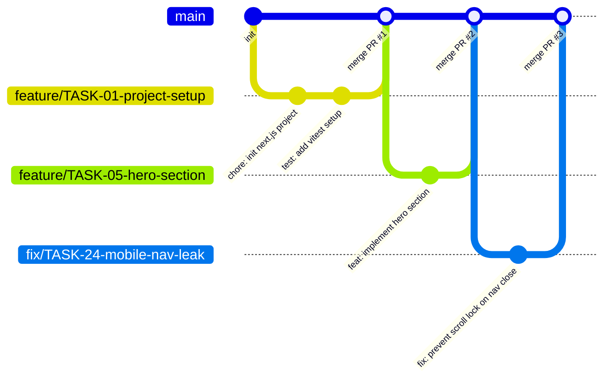

# Git Workflow - Quy trình Quản lý Mã nguồn Portfolio

Tài liệu này quy định toàn bộ tiêu chuẩn quản lý mã nguồn, chiến lược phân nhánh (Branching Strategy), quy ước đặt tên nhánh và quy chuẩn viết thông điệp commit (Conventional Commits) cho dự án.

---

## 1. Chiến lược Phân nhánh (Branching Strategy)

Dự án áp dụng mô hình **GitHub Flow tinh gọn**, phù hợp cho cá nhân phát triển độc lập (Solo Developer) kết hợp quy trình tích hợp liên tục (CI/CD) hiện đại:



### Các nguyên tắc cốt lõi

1. **Nhánh `main` là nhánh nguồn chân lý (Source of Truth):**
   - Mã nguồn trên `main` luôn ở trạng thái sẵn sàng triển khai lên Production (Deployable).
   - Tuyệt đối không commit hoặc push code trực tiếp lên `main`.
   - Toàn bộ thay đổi phải thông qua Pull Request (PR) từ các nhánh tính năng.
2. **Nhánh Tính năng ngắn hạn (Short-lived Feature Branches):**
   - Mỗi nhánh chỉ phục vụ giải quyết đúng một mã công việc (`TASK-xx`) được định nghĩa trong `docs/roadmap.md`.
   - Vòng đời của nhánh không kéo dài quá 3 ngày để tránh xung đột mã nguồn phức tạp.
   - Sau khi PR được merge vào `main`, nhánh tính năng tương ứng trên GitHub phải được xóa tự động.

---

## 2. Quy ước Đặt tên Nhánh (Branch Naming Conventions)

Tên nhánh bắt buộc viết bằng chữ thường (kebab-case), phân tách bằng dấu gạch ngang `-`, theo cấu trúc chuẩn sau:

```
<loai-nhanh>/<ma-task>-<mo-ta-ngan>
```

| Tiền tố nhánh | Mục đích sử dụng | Ví dụ chuẩn |
| :--- | :--- | :--- |
| `feature/` | Xây dựng tính năng mới hoặc màn hình mới | `feature/TASK-05-hero-about-sections` |
| `fix/` | Sửa lỗi logic, sửa lỗi giao diện hoặc lỗi hồi quy | `fix/TASK-20-safari-backdrop-blur` |
| `docs/` | Viết hoặc cập nhật tài liệu đặc tả, README | `docs/TASK-02-update-api-specs` |
| `refactor/` | Tái cấu trúc code mà không đổi hành vi nghiệp vụ | `refactor/TASK-16-drizzle-queries-cleanup` |
| `test/` | Viết thêm Unit test hoặc Playwright E2E test | `test/TASK-22-contact-form-e2e` |
| `perf/` | Tối ưu hóa hiệu năng, giảm bundle size JS | `perf/TASK-23-optimize-image-loading` |
| `chore/` | Cập nhật dependency, cấu hình tooling, CI/CD | `chore/TASK-01-setup-eslint-prettier` |

---

## 3. Chuẩn Viết Thông điệp Commit (Conventional Commits v1.0.0)

Mỗi commit message phải tuân thủ nghiêm ngặt chuẩn Conventional Commits. Điều này giúp lịch sử Git sạch sẽ, tự động sinh changelog và tạo ấn tượng chuyên nghiệp cao nhất đối với nhà tuyển dụng khi đọc kho mã nguồn.

### Cấu trúc Chuẩn

```
<type>(<scope>): <mo-ta-ngan-gon-bang-tieng-viet-hoac-tieng-anh>

[phan-than-giai-thich-chi-tiet-neu-can]

[phan-chan-tham-chieu-task-hoac-breaking-changes]
```

### 3.1. Các Loại Commit (`type`)

- `feat`: Thêm tính năng mới cho người dùng (tương ứng với thay đổi chức năng).
- `fix`: Sửa lỗi cho người dùng hoặc khắc phục ngoại lệ hệ thống.
- `docs`: Chỉ thay đổi tài liệu (Markdown, README, hướng dẫn).
- `style`: Thay đổi không ảnh hưởng đến logic code (khoảng trắng, format, chấm phẩy).
- `refactor`: Sửa code không sửa tính năng và không sửa lỗi (tách hàm, đổi tên biến).
- `perf`: Thay đổi mã nguồn nhằm cải thiện tốc độ tải hoặc giảm tiêu thụ RAM/CPU.
- `test`: Thêm mới hoặc sửa đổi các bộ test case có sẵn.
- `build`: Thay đổi ảnh hưởng đến hệ thống build hoặc package ngoài (Next.js config, pnpm).
- `ci`: Thay đổi các file cấu hình tích hợp liên tục (GitHub Actions, Vercel scripts).
- `chore`: Các tác vụ quản trị mã nguồn vụn vặt khác không can thiệp vào code ứng dụng.

### 3.2. Phạm vi Commit (`scope`)

Phạm vi là tùy chọn nhưng được khuyến khích sử dụng để xác định module bị tác động:
- `home`, `projects`, `lab`, `guestbook`, `contact`
- `ui`, `theme`, `command-palette`, `telemetry`
- `db`, `auth`, `rate-limit`, `api`, `deps`

### 3.3. Các Ví dụ Commit Message Chuẩn

**Ví dụ 1: Thêm tính năng mới (Feature)**
```
feat(guestbook): implement optimistic ui for new entry submission

- Use React useOptimistic hook to render pending entry immediately
- Rollback entry state if server action returns an error
- Reset form inputs on successful server acknowledgement

Refs: TASK-18
```

**Ví dụ 2: Sửa lỗi (Bug Fix)**
```
fix(theme): eliminate light-to-dark flash on initial page load

Inject inline blocking script in root layout to evaluate localStorage
and apply dark class to html element before first paint.

Fixes: TASK-03
```

**Ví dụ 3: Tối ưu hiệu năng (Performance)**
```
perf(projects): convert static cover images to dynamic webp/avif

Replace standard img tags with next/image, specify width/height to
eliminate Cumulative Layout Shift (CLS) on mobile devices.

Refs: TASK-23
```

---

## 4. Quy trình Đóng góp và Hợp nhất Mã nguồn (Pull Request Workflow)

1. **Khởi tạo nhánh mới từ `main` mới nhất:**
   ```bash
   git checkout main
   git pull origin main
   git checkout -b feature/TASK-18-guestbook-optimistic-ui
   ```
2. **Thực hiện công việc và commit thường xuyên:**
   - Mỗi commit giải quyết một đơn vị thay đổi logic độc lập.
   - Không gộp hàng chục file không liên quan vào một commit duy nhất.
3. **Kiểm tra chất lượng cục bộ trước khi push (Local Pre-push Check):**
   Trước khi đẩy nhánh lên GitHub, bắt buộc chạy chuỗi lệnh kiểm tra:
   ```bash
   pnpm lint
   pnpm typecheck
   pnpm test
   ```
   Nếu có bất kỳ lỗi nào xuất hiện, phải sửa dứt điểm trước khi push.
4. **Đẩy nhánh lên GitHub và Mở Pull Request:**
   ```bash
   git push -u origin feature/TASK-18-guestbook-optimistic-ui
   ```
   - Điền đầy đủ thông tin vào mẫu PR Template (`.github/pull_request_template.md`).
   - Liên kết mã Task liên quan trong phần mô tả.
5. **Hợp nhất (Merge Strategy):**
   - **Chỉ sử dụng phương thức `Squash and merge`:** Toàn bộ các commit nhỏ trong nhánh tính năng sẽ được gộp thành một commit duy nhất, sạch sẽ trên nhánh `main`.
   - Tiêu đề của commit khi squash phải tuân thủ đúng chuẩn Conventional Commits (ví dụ: `feat(guestbook): implement optimistic ui (#18)`).
   - Xóa nhánh tính năng ngay sau khi merge thành công.

---

## 5. Nguyên tắc An toàn và Phòng ngừa Rủi ro Mã nguồn

1. **Không bao giờ push Secret hoặc Token vào Git:**
   - Các tệp `.env`, `.env.local`, `.env.production` bắt buộc phải nằm trong `.gitignore`.
   - Nếu vô tình commit secret lên GitHub: Coi như secret đó đã bị lộ 100%. Phải lập tức thu hồi (Revoke/Rotate) secret trên Dashboard dịch vụ (GitHub OAuth, Supabase, Resend) và tạo secret mới, không chỉ đơn thuần là xóa commit trong Git.
2. **Cấm tuyệt đối lệnh phá hủy trên nhánh chính:**
   - Nghiêm cấm chạy `git push --force` hoặc `git push -f` lên nhánh `main`.
   - Nghiêm cấm chạy `git reset --hard` khi chưa tạo nhánh sao lưu tạm thời.
3. **Khôi phục khi gặp sự cố trên Production:**
   - Nếu commit vừa merge lên `main` làm sập Production, sử dụng tính năng `Revert` của GitHub trên PR đó để tạo một PR hoàn tác nhanh chóng, merge vào `main` để đưa hệ thống về trạng thái ổn định trước khi tìm nguyên nhân gốc (Root Cause).
