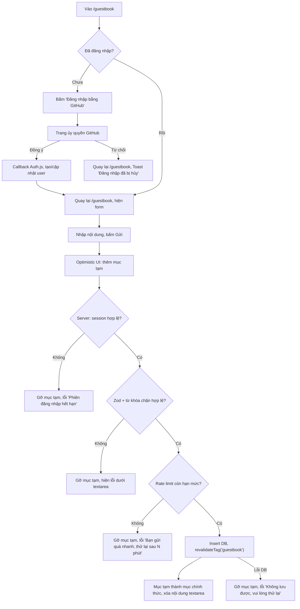

# Spec - Đặc tả chức năng Portfolio

Tài liệu này mô tả chính xác hệ thống phải làm gì. Mỗi yêu cầu có mã định danh để tham chiếu trong `roadmap.md` và test case.

- `FR-xx-yy`: Functional Requirement (yy là số thứ tự trong tính năng xx).
- `NFR-xx`: Non-functional Requirement.
- `BR-xx`: Business Rule.

---

## 1. Sơ đồ trang (Sitemap)

| Route | Loại render | Mô tả |
| :--- | :--- | :--- |
| `/` | SSG | Trang chủ |
| `/projects` | SSG | Danh sách dự án, lọc phía client |
| `/projects/[slug]` | SSG (`generateStaticParams`) | Trang Case Study |
| `/lab` | SSG | Component Lab |
| `/guestbook` | Dynamic (đọc session) + dữ liệu cache có tag | Sổ lưu niệm |
| `/contact` | SSG + Server Action | Form liên hệ |
| `/api/auth/[...nextauth]` | Route Handler | Endpoint của Auth.js |
| `/api/views/[slug]` | Route Handler (POST, GET) | Tăng và đọc lượt xem |
| `/api/telemetry` | Route Handler (GET, ISR 3600 giây) | Dữ liệu GitHub activity |
| `/sitemap.xml` | Sinh từ `sitemap.ts` | Sitemap |
| `/robots.txt` | Sinh từ `robots.ts` | Robots |
| `/resume.pdf` | File tĩnh trong `public/` | CV |

---

## 2. Yêu cầu chức năng (Functional Requirements)

### F01 - Layout chung

| Mã | Yêu cầu |
| :--- | :--- |
| FR-01-01 | Header cố định trên cùng (sticky), gồm: logo chữ (tên viết tắt), menu `Projects`, `Lab`, `Guestbook`, `Contact`, nút mở Command Palette hiển thị gợi ý phím tắt, nút đổi theme. |
| FR-01-02 | Trên màn hình nhỏ hơn 768px, menu thu gọn thành nút hamburger, mở Mobile Nav dạng sheet trượt từ phải, đóng được bằng nút X, phím `Esc`, hoặc chạm vùng nền. |
| FR-01-03 | Header nền trong suốt khi ở đầu trang; khi cuộn quá 16px chuyển sang nền `surface` mờ (backdrop blur) và có border dưới. |
| FR-01-04 | Link menu của trang hiện tại có trạng thái active (màu `accent`, `aria-current="page"`). |
| FR-01-05 | Skip link "Bỏ qua đến nội dung chính" là phần tử focus đầu tiên, chỉ hiện khi được focus, nhảy đến `#main-content`. |
| FR-01-06 | Footer gồm: bản quyền và năm hiện tại, link GitHub, LinkedIn, Email, và Telemetry mini (commit SHA rút gọn 7 ký tự, liên kết đến commit trên GitHub; thời điểm build). |

### F02 - Trang chủ

| Mã | Yêu cầu |
| :--- | :--- |
| FR-02-01 | **Hero:** Hiển thị lời chào, họ tên, vai trò ("Web Developer"), một câu giá trị (tối đa 160 ký tự), trạng thái tìm việc (badge "Đang tìm cơ hội Intern/Fresher" có thể bật/tắt qua `site-config.ts`), 2 CTA: "Xem dự án" (đến `/projects`) và "Tải CV" (tải `/resume.pdf`). Toàn bộ nằm trong màn hình đầu ở viewport 375x667 và 1366x768. |
| FR-02-02 | **About:** Ảnh đại diện (dùng `next/image`, có `priority`), đoạn giới thiệu 3 đến 5 câu, thông tin nhanh: địa điểm, trường/khóa học, ngôn ngữ giao tiếp. |
| FR-02-03 | **Skills:** Kỹ năng nhóm theo 5 nhóm: Frontend, Backend, Database, DevOps và Tools, Kỹ năng mềm. Mỗi kỹ năng có icon (nếu có) và tên. Kỹ năng nào có tính năng chứng minh trên trang thì có link "Xem bằng chứng" dẫn đến tính năng đó (theo bảng ở `product.md` mục 5). Không dùng thanh phần trăm kỹ năng. |
| FR-02-04 | **Featured Projects:** Hiển thị tối đa 3 dự án có `featured: true` trong frontmatter, sắp xếp theo trường `order` tăng dần. Có link "Xem tất cả dự án". |
| FR-02-05 | **Experience Timeline:** Dòng thời gian dọc gồm học vấn, kinh nghiệm, giải thưởng, sắp xếp từ mới đến cũ. Mỗi mục: thời gian, tiêu đề, tổ chức, mô tả tối đa 3 gạch đầu dòng. |
| FR-02-06 | Section xuất hiện với hiệu ứng fade-in + dịch lên 8px khi vào viewport, chỉ chạy 1 lần. Tắt hoàn toàn khi người dùng bật `prefers-reduced-motion`. |

### F03 - Danh sách dự án

| Mã | Yêu cầu |
| :--- | :--- |
| FR-03-01 | Hiển thị toàn bộ dự án có `published: true`, dạng lưới: 1 cột (dưới 640px), 2 cột (640px đến 1023px), 3 cột (từ 1024px). |
| FR-03-02 | Mỗi Project Card gồm: ảnh cover (tỉ lệ 16:9), tiêu đề, tóm tắt (tối đa 2 dòng, cắt bằng line-clamp), tối đa 4 tech badge (dư thì hiển thị "+N"), năm thực hiện, link Demo và Source (nếu có). |
| FR-03-03 | Bộ lọc theo công nghệ dạng chip, chọn nhiều. Logic: dự án được hiển thị nếu chứa **tất cả** công nghệ đang chọn (AND). Có nút "Xóa bộ lọc". |
| FR-03-04 | Trạng thái lọc đồng bộ lên URL query (`/projects?tech=nextjs,postgresql`) để chia sẻ được. Tải trang với query hợp lệ thì áp dụng bộ lọc ngay. Giá trị không tồn tại trong danh sách tech bị bỏ qua. |
| FR-03-05 | Khi bộ lọc không cho kết quả, hiển thị Empty State "Không có dự án nào dùng đồng thời các công nghệ đã chọn" kèm nút "Xóa bộ lọc". |

### F04 - Trang Case Study

| Mã | Yêu cầu |
| :--- | :--- |
| FR-04-01 | Nội dung lấy từ `content/projects/<slug>.mdx`. `slug` là tên file. Trang được sinh tĩnh lúc build cho mọi dự án `published: true`. |
| FR-04-02 | Header Case Study: tiêu đề, tóm tắt, vai trò, thời gian, quy mô team, tech stack đầy đủ, link Demo, link Source, lượt xem. |
| FR-04-03 | Thân bài bắt buộc đủ 6 phần theo thứ tự: Bối cảnh và bài toán; Mục tiêu và ràng buộc; Kiến trúc giải pháp; Quyết định kỹ thuật và trade-off; Thách thức và cách giải quyết; Kết quả và bài học. Build thất bại nếu thiếu heading cấp 2 tương ứng (kiểm tra trong `lib/mdx.ts`). |
| FR-04-04 | MDX hỗ trợ component tùy biến: `<ArchitectureDiagram />` (render sơ đồ từ ảnh SVG có `alt` mô tả), `<Callout type="info|warning|success" />`, `<Metric label value />`, code block có highlight cú pháp và nút sao chép. |
| FR-04-05 | Mục lục (Table of Contents) tự sinh từ heading cấp 2 và cấp 3; trên desktop (từ 1280px) dính bên phải và đánh dấu mục đang đọc; trên mobile thu gọn thành khối có thể mở rộng ở đầu bài. |
| FR-04-06 | Cuối bài có điều hướng "Dự án trước" / "Dự án sau" theo trường `order`. |
| FR-04-07 | Truy cập slug không tồn tại hoặc `published: false` trả về trang 404. |
| FR-04-08 | Mỗi Case Study có Open Graph image sinh động (1200x630) gồm tiêu đề dự án, tech stack, tên chủ trang. |

### F05 - Bộ đếm lượt xem

| Mã | Yêu cầu |
| :--- | :--- |
| FR-05-01 | Khi trang Case Study được hiển thị ở client, gọi `POST /api/views/[slug]` một lần. |
| FR-05-02 | Server tính mã băm `ip_hash = SHA-256(IP + VIEW_SALT)`, kiểm tra khóa chống trùng `view_dedup:<slug>:<ip_hash>` với TTL 24 giờ (không lưu IP thô). Nếu khóa chưa tồn tại thì tăng bộ đếm `views:project:<slug>` và đặt khóa với TTL 24 giờ. |
| FR-05-03 | Response trả về tổng lượt xem hiện tại; UI hiển thị dạng "1,234 lượt xem" (định dạng `vi-VN`). |
| FR-05-04 | Khi Redis lỗi, không hiển thị số lượt xem (ẩn phần tử), không ném lỗi ra giao diện. |

### F06 - Command Palette

| Mã | Yêu cầu |
| :--- | :--- |
| FR-06-01 | Mở bằng `Ctrl + K` (Windows/Linux) hoặc `Cmd + K` (macOS), hoặc nút trên Header. Gợi ý phím tắt trên nút hiển thị đúng theo hệ điều hành. |
| FR-06-02 | Đóng bằng `Esc`, click ra ngoài, hoặc sau khi thực thi một lệnh. Khi đóng, focus trả về phần tử đã mở palette. |
| FR-06-03 | Nhóm lệnh: **Điều hướng** (Trang chủ, Projects, Lab, Guestbook, Contact); **Dự án** (mỗi dự án đã publish là một lệnh); **Giao diện** (Dark, Light, System); **Hành động** (Sao chép email, Tải CV, Mở GitHub, Mở LinkedIn). |
| FR-06-04 | Ô tìm kiếm lọc mờ (fuzzy) theo tên lệnh và từ khóa phụ (ví dụ lệnh "Projects" có từ khóa "dự án", "portfolio"). |
| FR-06-05 | Điều khiển bằng phím mũi tên lên/xuống, `Enter` để chọn. Lệnh đang được chọn có nền `surface-2`. |
| FR-06-06 | Không có kết quả: hiển thị "Không tìm thấy lệnh phù hợp". |
| FR-06-07 | "Sao chép email" ghi email vào clipboard và hiện Toast "Đã sao chép email". Nếu Clipboard API không khả dụng, hiện Toast lỗi kèm email dạng text để người dùng tự sao chép. |
| FR-06-08 | Palette tuân thủ mẫu ARIA combobox/listbox (do `cmdk` cung cấp), có `aria-label` "Bảng lệnh". |

### F07 - Theme

| Mã | Yêu cầu |
| :--- | :--- |
| FR-07-01 | 3 chế độ: Dark, Light, System. Mặc định: System. |
| FR-07-02 | Lựa chọn lưu trong `localStorage` khóa `theme`. |
| FR-07-03 | Không có hiện tượng nháy theme sai khi tải trang: script inline chạy trước khi render để gán class `dark` lên `<html>`. |
| FR-07-04 | Khi ở chế độ System, đổi theme hệ điều hành thì trang cập nhật ngay không cần tải lại. |
| FR-07-05 | Nút theme trên Header là dropdown 3 lựa chọn, có `aria-label` "Đổi giao diện", mục đang chọn có dấu check. |

### F08 - Guestbook

| Mã | Yêu cầu |
| :--- | :--- |
| FR-08-01 | Ai cũng xem được danh sách lời nhắn, không cần đăng nhập. |
| FR-08-02 | Danh sách sắp xếp mới nhất trước, tải 20 mục mỗi lần, nút "Xem thêm" tải tiếp theo cursor (dựa trên `created_at` và `id`). |
| FR-08-03 | Mỗi lời nhắn hiển thị: avatar GitHub, tên hiển thị, username GitHub (link đến profile), nội dung, thời gian tương đối ("3 phút trước"); di chuột/focus vào thời gian hiện thời gian đầy đủ. |
| FR-08-04 | Chưa đăng nhập: hiển thị nút "Đăng nhập bằng GitHub để để lại lời nhắn". Sau khi đăng nhập thành công, quay lại `/guestbook`. |
| FR-08-05 | Đã đăng nhập: hiển thị form gồm textarea và bộ đếm ký tự còn lại, nút "Gửi", và link "Đăng xuất". |
| FR-08-06 | Gửi lời nhắn dùng Server Action; UI cập nhật lạc quan (optimistic) ngay khi bấm Gửi, mục tạm có độ mờ 60% cho đến khi server xác nhận. Nếu server từ chối, mục tạm bị gỡ và hiện thông báo lỗi. |
| FR-08-07 | Tác giả thấy nút "Xóa" trên lời nhắn của mình. Admin thấy nút "Xóa" trên mọi lời nhắn. Bấm Xóa mở hộp thoại xác nhận. |
| FR-08-08 | Xóa là xóa mềm (đặt `deleted_at`), lời nhắn bị ẩn khỏi danh sách công khai. |
| FR-08-09 | Lời nhắn của admin có badge "Chủ trang". |
| FR-08-10 | Nội dung hiển thị dạng văn bản thuần, giữ xuống dòng, không render HTML hoặc Markdown. URL trong nội dung không được tự chuyển thành link. |

### F09 - Contact form

| Mã | Yêu cầu |
| :--- | :--- |
| FR-09-01 | Form gồm: Họ tên, Email, Chủ đề (select: "Cơ hội việc làm", "Hợp tác dự án", "Góp ý", "Khác"), Nội dung, và trường honeypot `website` bị ẩn bằng CSS và `aria-hidden`, `tabIndex=-1`. |
| FR-09-02 | Validate phía client bằng cùng Zod schema với server; lỗi hiện dưới từng trường, liên kết bằng `aria-describedby`. |
| FR-09-03 | Gửi bằng Server Action. Trong lúc gửi, nút chuyển sang trạng thái loading và form bị khóa. |
| FR-09-04 | Thành công: lưu bản ghi vào bảng `contact_messages`, gửi email thông báo cho chủ trang qua Resend (trường `reply-to` là email người gửi), reset form, hiện thông báo "Đã gửi. Mình sẽ phản hồi trong vòng 48 giờ". |
| FR-09-05 | Nếu lưu database thành công nhưng gửi email thất bại: vẫn báo thành công cho người dùng, đánh dấu `email_status = 'failed'` để chủ trang kiểm tra trong database. |
| FR-09-06 | Bên cạnh form hiển thị kênh liên hệ trực tiếp: email (có nút sao chép), LinkedIn, GitHub. |

### F10 - Component Lab

| Mã | Yêu cầu |
| :--- | :--- |
| FR-10-01 | Trang `/lab` liệt kê 3 component: Button, Toast, Tabs. Mỗi component là một tab trong thanh chọn. |
| FR-10-02 | Mỗi component có 3 vùng: Preview (render trực tiếp), Props Panel (điều khiển props), Code (đoạn JSX tương ứng với props hiện tại, có nút sao chép). |
| FR-10-03 | **Button props:** `variant` (primary, secondary, ghost, danger), `size` (sm, md, lg), `loading` (boolean), `disabled` (boolean), `iconLeft` (boolean), nhãn (text, tối đa 24 ký tự). |
| FR-10-04 | **Toast props:** `type` (info, success, warning, error), `title` (tối đa 40 ký tự), `description` (tối đa 120 ký tự), `duration` (2000, 4000, 8000 ms), `position` (top-right, bottom-right, bottom-center). Có nút "Hiện Toast". |
| FR-10-05 | **Tabs props:** số tab (2 đến 5), `orientation` (horizontal, vertical), `variant` (underline, pill). Tabs điều khiển được bằng phím mũi tên, `Home`, `End` theo chuẩn WAI-ARIA Tabs. |
| FR-10-06 | Trạng thái props đồng bộ lên URL query để chia sẻ đúng cấu hình đang xem. |
| FR-10-07 | Mỗi component có ghi chú "Accessibility" liệt kê thuộc tính ARIA và phím tắt mà component hỗ trợ. |
| FR-10-08 | Component được viết tay trong `src/components/ui/`, không import từ thư viện UI bên ngoài (chỉ được dùng tiện ích như `clsx`). |

### F11 - Live Telemetry

| Mã | Yêu cầu |
| :--- | :--- |
| FR-11-01 | Widget trên trang chủ (cuối trang, trước Footer) hiển thị: 5 sự kiện GitHub công khai gần nhất (push, PR, tạo repo) gồm loại sự kiện, tên repo, thời gian tương đối; tổng số contribution trong 12 tháng gần nhất. |
| FR-11-02 | Dữ liệu lấy qua `GET /api/telemetry`, server gọi GitHub GraphQL API bằng token chỉ đọc, cache 3600 giây. |
| FR-11-03 | Footer hiển thị commit SHA của bản đang deploy (đọc từ biến hệ thống của Vercel), liên kết đến commit trên GitHub, và thời điểm build (ghi lúc build). Ở môi trường local hiển thị "local". |
| FR-11-04 | Khi GitHub API lỗi hoặc vượt rate limit: widget hiển thị trạng thái lỗi "Không tải được hoạt động GitHub" kèm link đến profile GitHub, không làm vỡ trang. |
| FR-11-05 | Trong lúc tải: hiển thị skeleton 5 dòng. |

### F12 - SEO

| Mã | Yêu cầu |
| :--- | :--- |
| FR-12-01 | Mỗi trang có `title` theo mẫu `<Tên trang> | <Họ tên>`, `description` riêng, `canonical` URL. |
| FR-12-02 | Open Graph và Twitter Card cho mọi trang; trang chủ dùng OG image mặc định sinh động; Case Study dùng OG image riêng (FR-04-08). |
| FR-12-03 | `sitemap.xml` liệt kê mọi route công khai và mọi Case Study đã publish, có `lastModified`. |
| FR-12-04 | `robots.txt` cho phép tất cả, chặn `/api/`, trỏ tới sitemap. |
| FR-12-05 | Trang chủ có JSON-LD `Person` (tên, vai trò, link mạng xã hội). |

### F13 - Trang lỗi

| Mã | Yêu cầu |
| :--- | :--- |
| FR-13-01 | 404: thông báo "Không tìm thấy trang", gợi ý mở Command Palette, nút về trang chủ. |
| FR-13-02 | Lỗi runtime (`error.tsx`): thông báo "Đã có lỗi xảy ra", nút "Thử lại" gọi `reset()`, nút về trang chủ. Không hiển thị stack trace ở production. |

### F14 - Tải CV

| Mã | Yêu cầu |
| :--- | :--- |
| FR-14-01 | File `public/resume.pdf`, dung lượng dưới 1 MB. Nút "Tải CV" dùng thuộc tính `download` với tên file `CV-<Ho-Ten>-WebDeveloper.pdf`. |

---

## 3. Yêu cầu phi chức năng (Non-functional Requirements)

| Mã | Nhóm | Yêu cầu |
| :--- | :--- | :--- |
| NFR-01 | Hiệu năng | Lighthouse mobile của `/` và một trang Case Study: Performance, Accessibility, Best Practices, SEO đều từ 95 trở lên. |
| NFR-02 | Hiệu năng | LCP dưới 2.5 giây, CLS dưới 0.1, INP dưới 200 ms (theo PageSpeed Insights mobile). |
| NFR-03 | Hiệu năng | JavaScript gửi xuống client cho trang chủ (First Load JS theo báo cáo `next build`) dưới 150 KB gzip. Component chỉ là Client Component khi cần tương tác. |
| NFR-04 | Hiệu năng | Ảnh dùng `next/image`, định dạng AVIF/WebP tự động, có `width`/`height` hoặc `fill` + `sizes` để tránh layout shift. |
| NFR-05 | Accessibility | Tuân thủ WCAG 2.1 mức AA: tỉ lệ tương phản chữ thường từ 4.5:1, chữ lớn từ 3:1; mọi chức năng dùng được bằng bàn phím; focus ring luôn nhìn thấy. |
| NFR-06 | Accessibility | Mọi ảnh có `alt` có nghĩa (ảnh trang trí dùng `alt=""`); mọi nút chỉ có icon có `aria-label`. |
| NFR-07 | Accessibility | Tôn trọng `prefers-reduced-motion`: tắt animation di chuyển, chỉ giữ thay đổi opacity tối đa 150ms. |
| NFR-08 | Bảo mật | Mọi input từ người dùng validate bằng Zod tại server, kể cả khi client đã validate. |
| NFR-09 | Bảo mật | Security headers: `Content-Security-Policy`, `X-Content-Type-Options: nosniff`, `Referrer-Policy: strict-origin-when-cross-origin`, `X-Frame-Options: DENY`, `Permissions-Policy` tắt camera, microphone, geolocation. |
| NFR-10 | Bảo mật | Secret chỉ tồn tại trong biến môi trường server; không biến nào chứa secret được đặt tiền tố `NEXT_PUBLIC_`. Biến môi trường được validate bằng Zod lúc khởi động (`lib/env.ts`). |
| NFR-11 | Bảo mật | Không lưu IP thô; chỉ lưu hash SHA-256 có salt. |
| NFR-12 | Độ tin cậy | Lỗi từ dịch vụ bên ngoài (GitHub, Redis, Resend) không làm sập trang; mỗi tính năng có trạng thái lỗi riêng (graceful degradation). |
| NFR-13 | Tương thích | Hoạt động đúng trên 2 phiên bản mới nhất của Chrome, Edge, Firefox, Safari (desktop và iOS), Chrome Android. Viewport tối thiểu 320px. |
| NFR-14 | Chất lượng code | TypeScript `strict: true`, không dùng `any` (ESLint báo lỗi). ESLint và Prettier pass. |
| NFR-15 | Kiểm thử | Unit test cho mọi Zod schema, hàm rate limit, hàm tiện ích MDX; E2E cho 5 luồng: điều hướng, Command Palette, lọc dự án, gửi Contact form (mock email), Guestbook khi chưa đăng nhập. |
| NFR-16 | Bảo trì | Thêm dự án mới chỉ cần thêm 1 file MDX và ảnh, không sửa code TypeScript. |
| NFR-17 | Chi phí | Toàn bộ hạ tầng nằm trong gói miễn phí. |

---

## 4. Quy tắc nghiệp vụ (Business Rules)

| Mã | Quy tắc |
| :--- | :--- |
| BR-01 | Nội dung lời nhắn Guestbook: sau khi `trim()`, độ dài từ 1 đến 280 ký tự. Gộp 3 dòng trống liên tiếp trở lên thành 2 dòng. |
| BR-02 | Một user được tạo tối đa 3 lời nhắn trong cửa sổ trượt 10 phút (rate limit theo `user_id`). |
| BR-03 | Một user được tạo tối đa 20 lời nhắn còn hiệu lực (chưa xóa) trong toàn bộ thời gian. |
| BR-04 | Lời nhắn chứa từ khóa nằm trong danh sách chặn (`lib/moderation.ts`) bị từ chối với thông báo chung "Nội dung không phù hợp". Danh sách chặn không công khai trên giao diện. |
| BR-05 | Chỉ tác giả hoặc admin được xóa lời nhắn. Admin xác định bằng GitHub user ID trùng với biến môi trường `ADMIN_GITHUB_ID` (so sánh ID số, không so sánh username vì username có thể đổi). |
| BR-06 | Contact form: Họ tên 2 đến 80 ký tự; Email đúng định dạng, tối đa 254 ký tự; Chủ đề thuộc 4 giá trị cho phép; Nội dung 20 đến 2000 ký tự. |
| BR-07 | Contact form: tối đa 3 lần gửi mỗi giờ theo hash IP (cửa sổ trượt). |
| BR-08 | Contact form: nếu trường honeypot `website` có giá trị, server trả về thành công giả (không lưu, không gửi email) để bot không phát hiện. |
| BR-09 | Contact form: nếu thời gian từ lúc form render đến lúc submit dưới 3 giây, xử lý như bot (giống BR-08). Thời điểm render được gửi kèm dạng timestamp có chữ ký HMAC để không giả mạo được. |
| BR-10 | Lượt xem Case Study: mỗi tổ hợp (IP hash, slug) chỉ được tính 1 lần trong 24 giờ. |
| BR-11 | `POST /api/views/[slug]` chỉ chấp nhận slug tồn tại trong danh sách dự án đã publish; slug khác trả về 404 và không tạo khóa Redis. |
| BR-12 | Rate limit cho endpoint lượt xem: tối đa 30 request mỗi phút theo IP hash. |
| BR-13 | Dự án chỉ xuất hiện công khai khi frontmatter có `published: true`. |
| BR-14 | Featured Projects trên trang chủ: tối đa 3; nếu có nhiều hơn 3 dự án `featured: true`, lấy 3 dự án có `order` nhỏ nhất. |
| BR-15 | Mọi thời gian lưu trong database ở UTC (`timestamptz`); hiển thị theo múi giờ `Asia/Ho_Chi_Minh`. |

---

## 5. Luồng người dùng (User Flows)

### UF-01: HR xem nhanh và tải CV

1. HR mở link portfolio từ CV trên điện thoại.
2. Trang chủ tải, Hero hiển thị họ tên, vai trò, câu giá trị, badge trạng thái tìm việc, 2 nút CTA.
3. HR bấm "Tải CV".
4. Trình duyệt tải file `CV-<Ho-Ten>-WebDeveloper.pdf`.
5. HR cuộn xuống phần Skills để đối chiếu với yêu cầu vị trí.

**Ngoại lệ:**
- Bước 4, file không tồn tại (lỗi deploy): server trả 404. Phòng ngừa: E2E test kiểm tra `/resume.pdf` trả 200 trong CI.

### UF-02: Tech Lead khám phá bằng Command Palette

1. Tech Lead mở trang trên desktop, thấy gợi ý `Ctrl K` trên Header.
2. Nhấn `Ctrl + K`, palette mở, focus ở ô tìm kiếm.
3. Gõ "guest", danh sách lọc còn lệnh "Guestbook".
4. Nhấn `Enter`, palette đóng, điều hướng đến `/guestbook`.
5. Nhấn `Ctrl + K` lần nữa, chọn "Light", giao diện đổi sang sáng ngay lập tức.

**Ngoại lệ:**
- Đang focus trong textarea Guestbook mà nhấn `Ctrl + K`: palette vẫn mở (phím tắt toàn cục), nội dung textarea không bị thay đổi.
- Trình duyệt chiếm phím `Ctrl + K` (một số trình duyệt dùng để focus thanh tìm kiếm): gọi `preventDefault()` khi bắt sự kiện; nút trên Header luôn là phương án thay thế.

### UF-03: Đọc Case Study

1. Người dùng vào `/projects`, bấm chip "Next.js" và "PostgreSQL".
2. URL đổi thành `/projects?tech=nextjs,postgresql`, lưới chỉ còn dự án chứa cả 2 công nghệ.
3. Bấm vào một Project Card, chuyển đến `/projects/<slug>`.
4. Client gửi `POST /api/views/<slug>`, số lượt xem hiển thị ở Header Case Study.
5. Người dùng đọc, mục lục bên phải đánh dấu mục đang đọc.
6. Cuối bài, bấm "Dự án sau".

**Ngoại lệ:**
- Bước 2, không có dự án phù hợp: Empty State (FR-03-05).
- Bước 4, Redis lỗi: ẩn số lượt xem (FR-05-04).

### UF-04: Để lại lời nhắn Guestbook

### UF-05: Xóa lời nhắn

1. Tác giả (hoặc admin) bấm "Xóa" trên lời nhắn.
2. Hộp thoại xác nhận "Xóa lời nhắn này? Hành động không thể hoàn tác." với 2 nút "Hủy" và "Xóa".
3. Bấm "Xóa": Server Action kiểm tra session, kiểm tra quyền (BR-05), đặt `deleted_at`.
4. Lời nhắn biến khỏi danh sách, Toast "Đã xóa lời nhắn".

**Ngoại lệ:**
- Người không có quyền gọi trực tiếp Server Action (giả mạo request): server trả lỗi `FORBIDDEN`, không thay đổi dữ liệu.
- Lời nhắn đã bị xóa trước đó: server trả `NOT_FOUND`, UI gỡ mục khỏi danh sách và hiện Toast "Lời nhắn không còn tồn tại".

### UF-06: Gửi liên hệ

1. Người dùng vào `/contact`, điền form.
2. Rời khỏi một trường không hợp lệ (blur): lỗi hiện dưới trường.
3. Bấm "Gửi": nút chuyển loading, form bị khóa.
4. Server: kiểm tra honeypot và thời gian điền (BR-08, BR-09), rate limit (BR-07), Zod (BR-06), lưu DB, gửi email.
5. Thành công: form reset, thông báo thành công (FR-09-04).

**Ngoại lệ:**
- Vượt rate limit: thông báo "Bạn đã gửi quá nhiều lần. Vui lòng thử lại sau N phút hoặc gửi email trực tiếp đến <email>".
- Lỗi database: thông báo "Không gửi được tin nhắn. Vui lòng gửi email trực tiếp đến <email>", giữ nguyên dữ liệu đã nhập.
- Mất mạng khi gửi: thông báo "Mất kết nối mạng. Vui lòng kiểm tra và thử lại", giữ nguyên dữ liệu.

### UF-07: Thử Component Lab

1. Người dùng vào `/lab`, tab "Button" mặc định được chọn.
2. Trong Props Panel đổi `variant` thành `danger`, bật `loading`.
3. Preview cập nhật tức thì; khối Code hiển thị `<Button variant="danger" loading>Xóa dữ liệu</Button>`.
4. URL cập nhật thành `/lab?c=button&variant=danger&loading=true`.
5. Bấm "Sao chép code", Toast "Đã sao chép".

**Ngoại lệ:**
- URL có giá trị prop không hợp lệ (ví dụ `variant=abc`): bỏ qua giá trị đó, dùng giá trị mặc định.

---

## 6. Ma trận thông báo lỗi người dùng

| Tình huống | Thông báo hiển thị | Vị trí |
| :--- | :--- | :--- |
| Trường bắt buộc để trống | "Vui lòng nhập <tên trường>" | Dưới trường |
| Email sai định dạng | "Email không hợp lệ" | Dưới trường |
| Độ dài vượt giới hạn | "Tối đa N ký tự" | Dưới trường |
| Độ dài dưới giới hạn | "Tối thiểu N ký tự" | Dưới trường |
| Vượt rate limit | "Bạn thao tác quá nhanh. Vui lòng thử lại sau N phút" | Dưới form |
| Chưa đăng nhập / phiên hết hạn | "Phiên đăng nhập đã hết hạn. Vui lòng đăng nhập lại" | Dưới form |
| Không có quyền | "Bạn không có quyền thực hiện thao tác này" | Toast |
| Nội dung bị chặn | "Nội dung không phù hợp" | Dưới trường |
| Lỗi server không xác định | "Đã có lỗi xảy ra. Vui lòng thử lại" | Toast |
| Mất mạng | "Mất kết nối mạng. Vui lòng kiểm tra và thử lại" | Toast |

---

## 7. Decision Log (Đợt 1)

| Mã | Quyết định | Lý do | Phương án đã loại |
| :--- | :--- | :--- | :--- |
| D-01 | Dùng Next.js App Router thay vì Astro | Chứng minh được Server Actions, Server Components, auth - các kỹ năng nhà tuyển dụng Việt Nam hay yêu cầu với React/Next.js | Astro: nhanh hơn cho trang tĩnh nhưng thể hiện kém phần full-stack React |
| D-02 | Auth.js + Drizzle thay vì Supabase Auth | Thể hiện hiểu biết về luồng OAuth và quản lý session; không phụ thuộc chặt vào một nhà cung cấp | Supabase Auth: nhanh hơn nhưng che giấu phần lớn logic |
| D-03 | Guestbook dùng optimistic UI + revalidate thay vì realtime | Đủ trải nghiệm "thấy ngay" cho người gửi; giảm độ phức tạp đáng kể | Supabase Realtime / WebSocket: để Phase sau |
| D-04 | Case Study dùng MDX trong repo thay vì CMS | Không tốn hạ tầng, version hóa bằng Git, chủ trang là developer | Headless CMS (Sanity, Contentful): thừa cho 1 người |
| D-05 | Không dùng thanh phần trăm kỹ năng | Con số tự chấm không có ý nghĩa, Tech Lead đánh giá tiêu cực | Progress bar, biểu đồ radar |
| D-06 | Nội dung MVP bằng Tiếng Việt | Thị trường mục tiêu là doanh nghiệp tại Việt Nam; i18n để Phase sau | Song ngữ ngay từ đầu |
| D-07 | Xóa mềm Guestbook | Cho phép admin khôi phục khi xóa nhầm, giữ dấu vết khi có tranh chấp nội dung | Xóa cứng |
